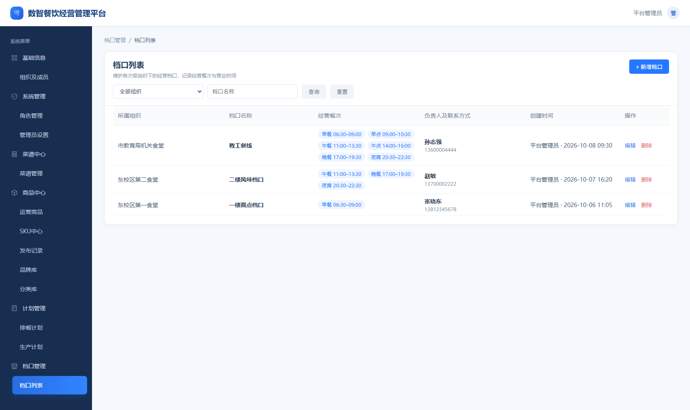
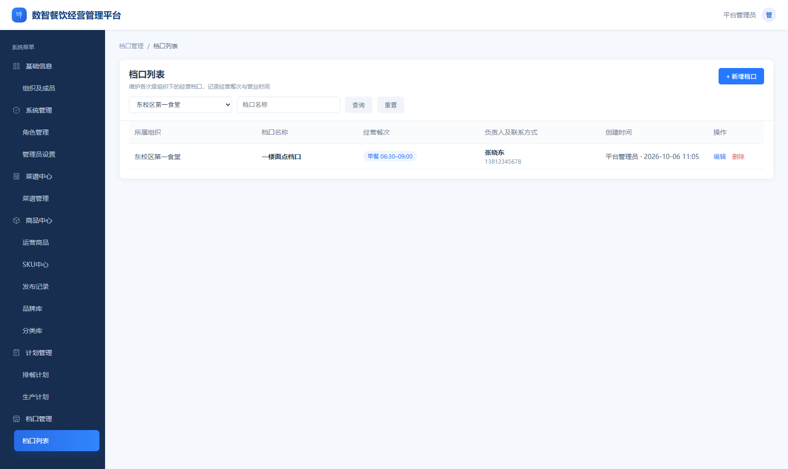
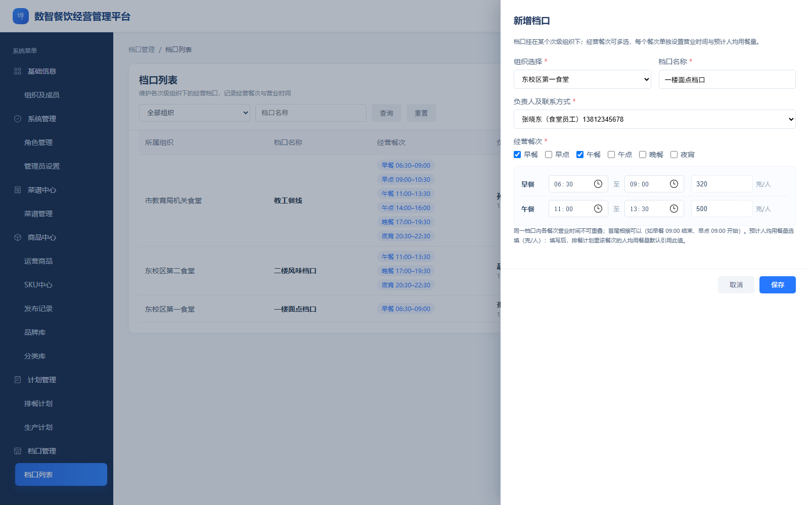
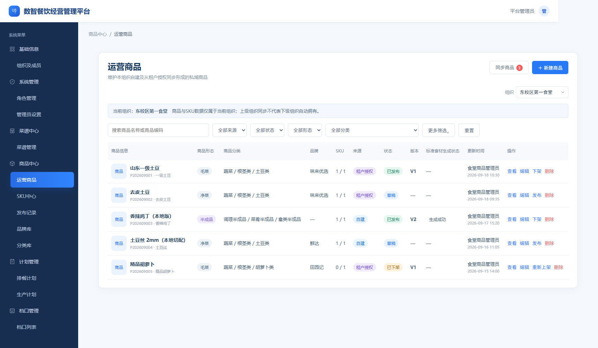
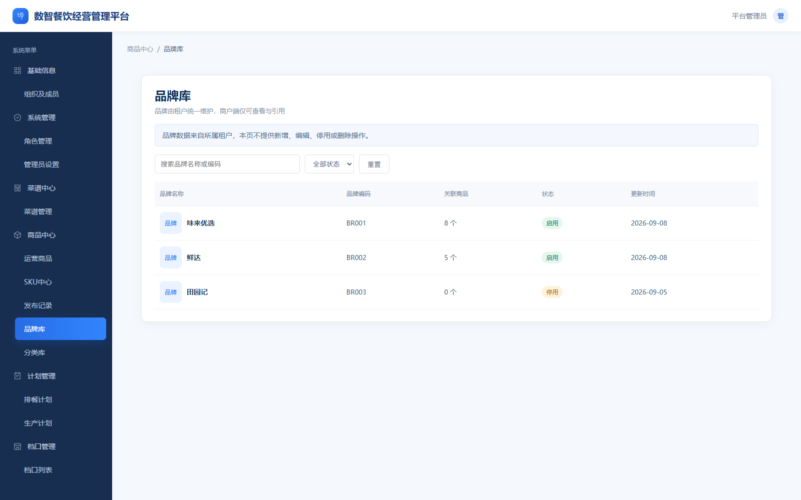
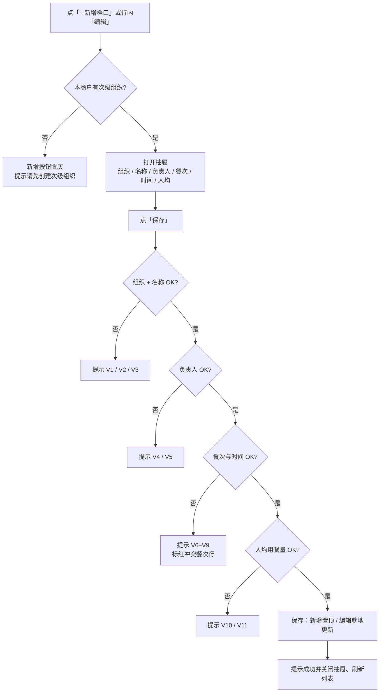
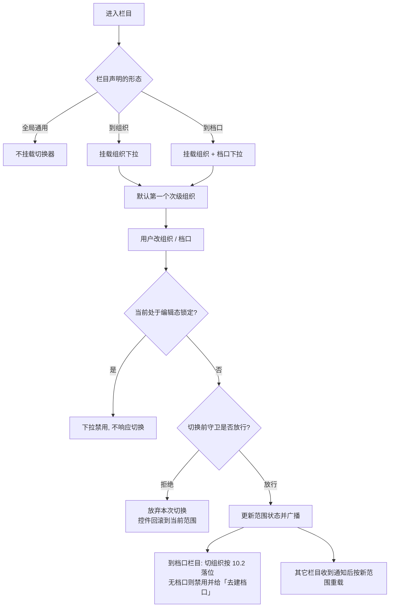

# 商户端 · 档口列表与组织/档口切换器 PRD

| 项目 | 内容 |
| --- | --- |
| 文档名称 | 商户端 · 档口列表与组织/档口切换器 PRD |
| 版本 | V1.0 |
| 日期 | 2026-10-12 |
| 适用范围 | 食联网数智餐饮平台 · 商户端「档口管理 → 档口列表」＋ 多栏目共用的「范围切换器」 |
| 配套原型 | 商户端原型 `食联网数智餐饮平台-组织及人员.html`（本文截图取自该原型当前实现） |
| 关联文档 | 《商户端菜谱管理 PRD》《商户端商品中心 PRD》；《商户端计划管理 PRD》（仅作切换器的消费方背景） |
| 文档性质 | 第一期产品需求基线（页面 / 字段 / 交互 / 组件契约级） |

## 1 文档信息

### 1.1 事实来源标注约定

| 标记 | 含义 |
| --- | --- |
| **【已确认】** | 本轮已拍板的口径，可直接实现 |
| **【原型】** | 取自当前原型实现的事实，证明「现在是怎么做的」，不等于业务要求 |
| **【待修正】** | 已确认口径与原型实现不一致，研发需按本文调整 |

### 1.2 与计划类栏目的关系

档口数据与切换器都会被计划类栏目（排餐计划、生产计划）消费，但这两个栏目尚未评审。本文只定义两件事：

1. **档口主数据的维护规则**——档口列表（第 5～8 章）；
2. **切换器作为共用组件的形态与范围规则**——第 9～12 章。

计划类栏目自身的业务规则不在本文范围，待其评审时另行补充；本文只约定它们作为「到档口」形态消费方应遵守的组件契约。

## 2 需求背景与目标

**背景**

- 商户下的「次级组织」（食堂 / 档口类经营单元）已在「组织及成员」维护，但缺少在其下维护「经营档口」的入口，档口此前只存在于演示数据中。
- 各业务栏目需要按「组织」或「组织 + 档口」定位作业范围，此前没有统一的范围选择方式，容易出现各页各写一套、切换后数据串组织的问题。

**目标**

- 提供档口的**新增 / 编辑 / 删除 / 查询**能力，形成商户级档口主数据。
- 提供**一个共用范围切换器组件**，由各栏目按需声明形态：不挂 / 只切组织 / 切组织 + 档口。
- 统一范围口径：默认值、联动规则、编辑态锁定、切换前拦截、跨栏目共享全部由组件负责，栏目只消费结果。

## 3 范围与术语

### 3.1 术语

| 术语 | 定义 |
| --- | --- |
| 商户 | 使用商户端的经营主体，本文中「本商户全部次级组织」即其数据范围 |
| 顶级组织 | 商户下的最高层级组织，目前原型中只有一个 |
| 次级组织 | 挂在顶级组织下的经营单元（食堂 / 档口类），是档口的归属单位 |
| 档口 | 某个次级组织下的经营窗口，含经营餐次、各餐次营业时间、预计人均用餐量与负责人 |
| 经营餐次 | 档口对外供餐的餐次集合：早餐、早点、午餐、午点、晚餐、夜宵 |
| 营业时间 | 某个经营餐次的一段起止时间；**每个餐次只允许一段** |
| 预计人均用餐量 | 档口在某个餐次上的预计人均用餐量（克/人），非必填 |
| 负责人 | 档口唯一责任人，从**该档口所属次级组织**的成员中选择 1 人 |
| 范围切换器 | 挂在栏目标题行下方的共用控件，用于切换当前「组织」与「档口」范围 |
| 全局通用栏目 | 与组织无关的栏目（系统类、租户只读库等），不挂切换器 |
| 到组织栏目 | 数据按次级组织隔离、只需切换组织的栏目 |
| 到档口栏目 | 数据挂在档口上、需要先选组织再选档口的栏目（本文只约定组件行为） |

### 3.2 本期范围

- 档口列表页：入口、列表、查询、新增 / 编辑 / 删除、校验、空态。
- 范围切换器：三种形态的挂载规则、默认值与联动规则、锁定与切换前拦截、对外契约。
- 切换器消费方清单（栏目 × 形态）。

### 3.3 本期不包含

- 排餐计划、生产计划的页面与业务规则（另行评审）。
- 手机端（含手机端「切换食堂 / 档口」弹层）。
- 档口启用 / 停用状态、档口编码、档口层级（档口下再挂档口）、档口自定义排序。
- 档口经营数据统计（营业额、出餐量等）。
- 切换器的权限过滤（本期列出本商户全部次级组织）与「记忆上次选择」（本期刷新回默认）。

### 3.4 已确认决策

| 编号 | 决策 | 来源 |
| --- | --- | --- |
| D1 | 负责人候选 = **该档口所属次级组织**的成员，单选 1 人，不向下级组织取人 | 【已确认】 |
| D2 | 每个经营餐次只允许**一段**营业时间，不支持多时段 | 【已确认】 |
| D3 | 档口删除后不可恢复，下游**不再显示**该档口（不保留历史快照） | 【已确认】 |
| D4 | 预计人均用餐量：非必填；填写时须为**大于 0 的整数，上限 99999** 克/人 | 【已确认】 |
| D5 | 档口列表页**不挂切换器**，以「所属组织 + 档口名称」查询本商户全量档口 | 【已确认】 |
| D6 | 切换器为**一个共用组件**，按三种形态挂载；计划类栏目规格不在本文范围 | 【已确认】 |
| D7 | 本期**不写手机端** | 【已确认】 |
| D8 | 档口不设启用 / 停用状态与编码；同一组织内不可重名，跨组织可重名；列头不提供排序 | 【已确认】 |
| D9 | 档口记录中「所属组织」必填，且新增时组织下拉只列次级组织 | 【原型】 |

## 4 数据与归属

### 4.1 组织与档口的关系

- 一个次级组织可挂多个档口；一个档口必属于且仅属于一个次级组织。
- 档口数据只有**一个维护端**（档口列表）；切换器只读，不修改档口数据。

### 4.2 档口字段

| 字段 | 必填 | 说明 |
| --- | --- | --- |
| 所属组织 | 是 | 次级组织；组织下拉只列次级组织 |
| 档口名称 | 是 | 最长 30 字 |
| 负责人 | 是 | 该组织成员，单选题；展示名称 + 联系方式 |
| 经营餐次 | 是 | 至少 1 个，可多选 |
| 各餐次营业时间 | 是 | 每个已选餐次一段起止时间，精确到分钟 |
| 各餐次预计人均用餐量 | 否 | 克/人，正整数，≤ 99999 |
| 创建人 / 创建时间 | 系统 | 列表「创建时间」列展示为「创建人 · 时间」 |

### 4.3 变动传导

| 变动 | 结果 | 来源 |
| --- | --- | --- |
| 档口被删除 | 列表不再出现；切换器的档口下拉中不再出现；已消费该档口的栏目在重新取数后不再显示 | D3 + 【原型】 |
| 次级组织被删除 | 档口记录保留，列表「所属组织」显示「—」；编辑时组织下拉中无原组织，保存前需改挂到其它组织 | 【原型】 |
| 组织下无成员 | 新增 / 编辑时负责人下拉禁用，提示先到「组织及成员」添加成员 | 【原型】 |

## 5 档口列表

### 5.1 入口与布局

- 入口：左侧菜单一级「档口管理」→ 二级「档口列表」；面包屑「档口管理 / 档口列表」。
- 自上而下：标题区（标题、副标题「维护各次级组织下的经营档口，记录经营餐次与营业时间」、右上「＋ 新增档口」）→ 筛选行 → 表格 → 空态。**无分页器、无切换器**（D5）。

### 5.2 列表字段

| 列 | 内容 | 说明 |
| --- | --- | --- |
| 所属组织 | 组织名称 | 组织已不存在时显示「—」 |
| 档口名称 | 档口名称 | 加粗展示 |
| 经营餐次 | 餐次 + 时间段标签 | 按餐次顺序（早→夜宵）排列，如「早餐 06:30–09:00」 |
| 负责人及联系方式 | 姓名 + 手机号 | 无负责人时显示「—」 |
| 创建时间 | 创建人 · 创建时间 | — |
| 操作 | 编辑、删除 | 行内文字按钮 |

### 5.3 排序与分页

- 默认排序：按创建时间倒序（新建档口出现在首行）【原型】。
- 列头不提供排序功能（D8）。
- **不分页**：本期列表一次展示全部结果【原型】。

### 5.4 空态

| 场景 | 文案 | 新增按钮 |
| --- | --- | --- |
| 本商户无次级组织 | 当前商户还没有次级组织，请先到「组织及成员」创建次级组织 | 置灰，悬浮提示「请先创建次级组织」 |
| 无档口 | 暂无档口，点击「+ 新增档口」创建 | 可用 |
| 按组织筛选后该组织无档口 | 「{组织名称}」下暂无档口，可点击「+ 新增档口」创建 | 可用 |
| 查询无结果 | 没有匹配的档口，换个档口名称或组织再查 | 可用 |

## 6 查询与重置

| 控件 | 类型 | 规则 |
| --- | --- | --- |
| 所属组织 | 下拉 | 默认「全部组织」；选项 = 本商户全部次级组织 |
| 档口名称 | 输入框 | 占位「档口名称」，最长 30 字，按包含匹配 |
| 查询 | 按钮 | 按「所属组织 + 档口名称」过滤并刷新列表 |
| 重置 | 按钮 | 清空两个条件并刷新列表 |
| 回车 | 快捷操作 | 在档口名称输入框回车等同点击查询 |
| 清空输入 | 即时行为 | 清空档口名称后即时刷新列表【原型】 |

## 7 新增 / 编辑档口

### 7.1 入口与形态

- 新增：「＋ 新增档口」；编辑：行内「编辑」。
- 形态：右侧抽屉，标题「新增档口」/「编辑档口」，副提示「档口挂在某个次级组织下；经营餐次可多选，每个餐次单独设置营业时间与预计人均用餐量。」；底部「取消 / 保存」。

### 7.2 字段与校验

| 字段 | 控件 | 必填 | 规则 |
| --- | --- | --- | --- |
| 组织选择 | 下拉 | 是 | 只列次级组织；默认「请选择次级组织」；编辑时预填原组织 |
| 档口名称 | 输入 | 是 | 最长 30 字 |
| 负责人及联系方式 | 下拉 | 是 | 候选 = 所选组织的成员；未选组织时禁用并显示「请先选择组织」；该组织无成员时禁用并提示先添加成员 |
| 经营餐次 | 复选 | 是 | 至少 1 个；勾选后下方出现该餐次的时间与人均输入行，取消勾选即移除该行 |
| 各餐次营业时间 | 时间选择 | 是 | 一段起止；结束时间须晚于开始时间 |
| 各餐次预计人均用餐量 | 数字 | 否 | 正整数，> 0 且 ≤ 99999；单位「克/人」 |

### 7.3 经营餐次与营业时间规则

- 同一档口内各餐次时间**不可重叠**；首尾相接可以（如早餐 09:00 结束、早点 09:00 开始）。
- 校验不通过时提示并标红冲突的餐次行，抽屉不关闭。
- 抽屉内常驻规则提示：「同一档口内各餐次营业时间不可重叠；首尾相接可以。预计人均用餐量选填（克/人）。」

### 7.4 预计人均用餐量

- 非必填；留空即视为不设置，不做兜底填报。
- 校验：非空时必须是整数、大于 0、不超过 99999（D4）。
- 该值供下游栏目按该档口该餐次取默认值时使用，具体消费规则待对应栏目评审。

### 7.5 保存后置

| 动作 | 结果 |
| --- | --- |
| 新增保存 | 生成档口记录（所属组织、名称、负责人、餐次与时间、各餐次人均、创建人与创建时间），提示「档口创建成功」，按创建时间倒序出现在首行 |
| 编辑保存 | 就地更新该档口，提示「档口信息已保存」，列表刷新 |
| 编辑中切换组织 | 负责人被清空，提示「已切换组织，请重新选择负责人」，需重新选择后才能保存 |
| 校验不通过 | 提示对应文案，抽屉保持打开，已填内容不丢失 |

## 8 删除档口

- 入口：行内「删除」→ 二次确认弹窗：「确认删除档口「{档口名称}」吗？删除后不可恢复。」
- 确认后：提示「档口已删除」，列表刷新，记录不可恢复。
- 下游影响：消费档口的栏目在重新取数后**不再显示**该档口，不做历史快照（D3）。
- 档口不提供批量删除与导出。

## 9 范围切换器 · 定位与三种形态

### 9.1 组件定位

- 一个共用组件，挂载在**栏目标题行下方**独占一行（标题行右侧留给栏目自身的功能按钮）。
- 各栏目在渲染时声明形态：挂不挂、是否带档口。

### 9.2 三种形态与栏目清单

| 形态 | 说明 | 控件 | 当前消费方 |
| --- | --- | --- | --- |
| ① 全局通用，不挂切换器 | 数据与组织无关（或本身按组织全量展示、自带筛选），挂了会让人误以为切组织能看到别的数据 | 无 | 系统菜单类（组织及成员、角色管理、管理员设置）；商品中心「品牌库 / 分类库」（租户统一维护、商户只读）；菜谱中心「菜谱分类」（租户统一维护、商户只读）；档口管理「档口列表」（D5） |
| ② 到组织，只切组织 | 数据按次级组织隔离，只需确定组织 | 组织下拉 | 菜谱中心「菜谱管理」「菜谱库」；商品中心「运营商品 / SKU 中心 / 发布记录」 |
| ③ 到档口，组织 + 档口两级 | 数据挂在档口上，先选组织再选档口 | 组织下拉 + 档口下拉 | 计划类栏目（排餐计划、生产计划）——其页面规则另行评审，本文只约定组件行为 |

### 9.3 形态对照

② 到组织（商品中心 · 运营商品，标题下方仅有「组织」下拉）：

③ 到档口（组件形态示意，仅截取切换条本身：「组织」+「档口」两级，档口含「全部档口（总览）」选项）：

① 全局通用（商品中心 · 品牌库，无任何切换控件）：

## 10 范围切换器 · 范围规则与默认值

### 10.1 默认范围

- 进入任一挂了切换器的栏目，若尚未确定范围，默认落在**本商户第一个次级组织**。
- 形态 ③ 的栏目默认停在**该组织的「全部档口（总览）」**（用于查看该组织下各档口概览）；用户手动选过具体档口后，不再被默认值拉回。
- 范围状态**不落盘**：刷新页面回到默认范围（本期不做记忆）。

### 10.2 切换联动

| 操作 | 结果 |
| --- | --- |
| 形态 ② 换组织 | 只换组织；档口维度不参与 |
| 形态 ③ 换组织时当前在「全部档口（总览）」 | 保持「全部档口（总览）」，不自动进入新组织的某个档口 |
| 形态 ③ 换组织时当前在某个档口 | 落到**新组织的第一个档口**；新组织无档口时回到「全部档口（总览）」 |
| 形态 ③ 选具体档口 | 档口所属组织跟着档口走，组织下拉同步为该档口的组织 |
| 形态 ③ 从具体档口切回「全部档口（总览）」 | 档口清空，返回该组织总览 |

- 档口归属由所属组织决定：档口切换会带动组织，避免出现「组织 A + 档口属于 B」的组合。

### 10.3 跨栏目共享

- 范围状态**全局共享**：在任一栏目切换，其它已挂载该组件的栏目跟随更新并按新范围重新取数。
- 范围变更时，栏目自行丢弃与范围绑定的临时状态（筛选条件、未保存缓冲等）。

### 10.4 边界

| 场景 | 表现 |
| --- | --- |
| 本商户无次级组织 | 组织下拉禁用，显示「暂无次级组织」 |
| 当前组织无档口（形态 ③） | 档口下拉禁用，显示「该组织暂无档口」，并在旁给出「去建档口」入口 |
| 当前范围的组织被删除 | 回落到默认范围（第一个次级组织） |
| 当前范围的档口被删除 | 档口清空，回到「全部档口（总览）」 |

## 11 范围切换器 · 锁定、拦截与对外契约

### 11.1 编辑态锁定

- 栏目处于编辑中（存在未保存内容）时，可声明**锁定**：两个下拉均置灰且不响应切换，旁显示锁定说明（如「编辑中，保存或取消后可切换」）。
- 锁定由栏目声明，切换器不自行判断业务状态。

### 11.2 切换前守卫

- 切换器在真正切换前依次调用栏目注册的守卫；任一守卫返回拒绝，本次切换整体放弃，控件显示回滚到当前范围，由守卫自行提示（如「保存后切换」）。
- 守卫异常不阻断切换，仅记录。

### 11.3 「去建档口」跳转

- 形态 ③ 下当前组织没有档口时提供「去建档口」入口：跳转「档口管理 → 档口列表」并提示「该组织还没有档口，请先在「档口管理」创建」；若入口元素不存在，则提示「请先到「档口管理」为当前组织创建档口」。

### 11.4 对外契约

| 能力 | 说明 |
| --- | --- |
| 取当前范围 | 返回组织 id / 组织名 / 档口 id / 档口名（档口为空 = 总览层） |
| 列出次级组织 / 列出某组织档口 | 供栏目渲染自身筛选或做默认值判断 |
| 设定范围（组织 / 档口 / 清空档口） | 程序化切换，切换规则同 10.2 |
| 挂载（宿主元素 + 形态声明） | 形态声明至少包含：是否带档口、是否默认停总览、是否锁定 |
| 订阅范围变更 | 组织变更与档口变更分级通知，栏目据此重载 |
| 注册切换前守卫 | 返回拒绝即拦下本次切换 |

## 12 异常与边界

| 场景 | 表现 | 处理方 |
| --- | --- | --- |
| 本商户无次级组织 | 档口列表：空态文案 + 新增按钮置灰；切换器：组织下拉禁用显示「暂无次级组织」 | 列表 / 切换器 |
| 当前组织无档口 | 列表：按组织筛选后的空态；切换器：档口下拉禁用 +「去建档口」 | 列表 / 切换器 |
| 所属组织无成员 | 抽屉负责人下拉禁用并提示先到「组织及成员」添加成员，保存被拒（V4） | 抽屉 |
| 编辑中换组织 | 负责人清空并要求重选，未保存内容保留 | 抽屉 |
| 组织被删除 | 档口保留，「所属组织」显示「—」；保存前需改挂到其它组织 | 列表 |
| 档口被删除 | 列表与切换器均不再出现；消费方重新取数后不再显示（D3） | 列表 / 切换器 |
| 当前范围指向的组织 / 档口已不存在 | 回落到默认范围或「全部档口（总览）」 | 切换器 |
| 编辑态需要切范围 | 下拉禁用，提示「编辑中，保存或取消后可切换」 | 切换器 + 栏目 |
| 有未保存内容时切范围 | 守卫拒绝则整体放弃切换，控件回滚，由栏目提示 | 切换器 + 栏目 |
| 切换时栏目重载失败 | 范围状态已变更，栏目按自身异常处理呈现，不阻塞其它栏目 | 栏目 |

## 13 规则与文案清单

### 13.1 校验清单

| 编号 | 场景 | 提示文案 |
| --- | --- | --- |
| V1 | 未选择组织 | 请选择所属组织 |
| V2 | 档口名称为空 | 请输入档口名称 |
| V3 | 同一组织下已有同名档口 | 该组织下已存在同名档口 |
| V4 | 所属组织无成员 | 该组织暂无成员，请先到「组织及成员」添加后再选负责人 |
| V5 | 未选择负责人 | 请选择负责人 |
| V6 | 未勾选任何经营餐次 | 请至少选择 1 个经营餐次 |
| V7 | 某餐次未填时间 | 请填写{餐次}的营业开始/结束时间 |
| V8 | 结束时间早于或等于开始时间 | {餐次}的结束时间需晚于开始时间 |
| V9 | 两个餐次时间重叠 | {餐次A}与{餐次B}的营业时间重叠（{起}–{止}），请调整 |
| V10 | 人均用餐量非正整数 | {餐次}的预计人均用餐量需为大于 0 的数字 |
| V11 | 人均用餐量超上限 | {餐次}的预计人均用餐量不能超过 99999 克 |
| V12 | 档口名称超长 | 最长 30 字，超出不可输入 |

### 13.2 文案清单

| 位置 | 文案 |
| --- | --- |
| 页面标题 / 副标题 | 档口列表 / 维护各次级组织下的经营档口，记录经营餐次与营业时间 |
| 新增按钮 / 抽屉标题 | ＋ 新增档口 / 新增档口、编辑档口 |
| 保存成功 | 档口创建成功 / 档口信息已保存 |
| 删除确认 | 确认删除档口「{档口名称}」吗？删除后不可恢复。 |
| 删除成功 | 档口已删除 |
| 编辑中换组织 | 已切换组织，请重新选择负责人 |
| 切换器空态 | 暂无次级组织 / 该组织暂无档口 / 全部档口（总览） / 去建档口 |
| 切换器锁定 | 编辑中，保存或取消后可切换 |
| 无可建入口时提示 | 请先到「档口管理」为当前组织创建档口 |

### 13.3 流程图

**① 档口新增 / 编辑保存校验**

**② 切换器范围变更**

### 13.4 原型差异（研发需调整）

| 编号 | 差异 | 处理 |
| --- | --- | --- |
| P1 | 抽屉内「预计人均用餐量」原型上限为 9999，与 D4 的 99999 不一致 | **【待修正】** 按 99999 调整控件上限与校验文案 |
| P2 | 原型列表未做分页 | 与本文一致（本期不分页）；若后续数据量增长需分页，另行评审 |
