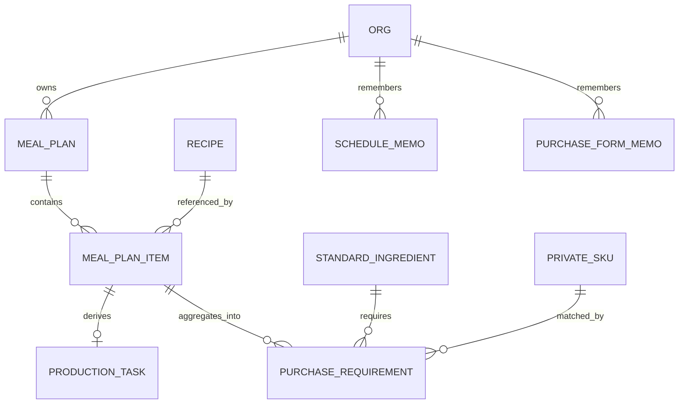

# 商户端计划管理 PRD

| 项目 | 内容 |
| --- | --- |
| 文档名称 | 商户端计划管理 PRD |
| 版本 | V1.1 |
| 日期 | 2026-09-23 |
| 适用范围 | 食联网数智餐饮平台 · 商户端「计划管理」（排餐计划 / 生产计划 / 采购计划） |
| 关联文档 | 《商户端菜谱管理 PRD》V1.0、《商户端商品中心 PRD》V1.0、《租户端菜谱管理与授权 PRD》V2.0、《数智餐饮运营管理平台—商品中心 PRD》V1.1 |
| 配套原型 | 商户端原型 `原型线上发布/merchant`（排餐计划、生产计划已实现；采购计划未开始） |
| 文档性质 | 第一期产品需求基线（页面 / 字段 / 计算规则 / 交互级） |

> **V1.1 变更摘要（2026-09-23）**
>
> 1. **用料换算从「占比分摊」改为「倍数放大」**：`倍数 k = 入锅投料总量 W ÷ 基准批次量 Q`，每行用量 `= 投料量 × k`。
>    两者在数学上等价，但倍数放大的**适用范围更大** —— 占比分摊在存在计数单位（个 / 只 / 条）行时算不出分母。
> 2. **基准批次量 Q 的定义**：纯人工菜按「一份」配置、含设备菜按「一批」配置；`Q` **不等于单锅产能**。
> 3. **排餐与设备彻底解耦**：排餐详情面板移除设备加工步骤、预计锅数；单锅产能改挂**设备型号主数据**。
> 4. **人均配量 / 出餐成品系数首次添加时沿用上周同一格**（同星期几 + 同餐次 + 同菜），取不到就留空必填；提示只在首次添加时出现，保存后不再提示。
> 5. **单位口径**：可折质量的行（克 / 千克 / 毫升 / 升）进合计，计数单位行进合计之外但仍按倍数放大。
> 6. 修正生产计划排程的**秒 / 分钟单位混用**缺陷（曾导致开工时间出现负值）。
> 7. **文案统一**：含设备菜的用料换算表头由「每批投料」改为「**菜谱投料**」（纯人工菜仍为「每份投料」），
>    说明行同步改为「菜谱投料 = 菜谱一次的投料量，与设备无关」。**计算口径不变**，仅文案调整。
> 8. **单位展示口径**：「菜谱投料」列按菜谱原单位展示、**不做进位**（设备菜用料单位统一为 `g`，故一律显示为 `g`）；
>    「本次用量」列仍按可读性进位。
> 9. **精度口径统一**：**出品量改为只读派生值**，取消「编辑出品量 → 反算人均配量」的反向路径；
>    人均配量精度由 6 位收紧为 **3 位（0.001 kg = 1 g）**，录入 / 存储 / 展示同一口径；
>    就餐人数限制为 1–9999；入锅投料总量展示改为 2 位。代价是倍数不再正好等于就餐人数（已确认接受）。
> 10. **公式行补全**：「入锅投料总量」行原先只回显 `91%`（漏了被除数），现回显完整算式 `12.72 ÷ 91%`；
>     详情面板内的出品量同步显示为 2 位，与公式里的操作数逐位一致。
> 11. **锅数产能来源修正（生产计划）**：锅数由「只取主加工步骤设备的容量」改为
>     **取该任务占用的所有设备 `⌈W ÷ C⌉` 的最大值**；换主加工设备 = 把原主设备上的步骤整体挪到新设备，
>     锅数随之按新设备集合重算。修掉两个实测复现的 bug：非主步骤在小设备上时锅数被低估、换设备后锅数留在旧产能上。
> 12. **新增每锅投料量（生产计划）**：任务表加一列、调整抽屉加总览格与「本任务用料」逐行值。
>     ~~`W ÷ 锅数`（均分）~~ → **第 17 条已改为「满锅 + 尾锅」口径**，本条仅保留列位。
> 13. **生产计划展示位数对齐**：出品量 / 入锅投料总量 / 每锅投料量统一 2 位小数。
> 14. **排产粒度定为设备型号**：不区分具体机台，同型号不并行（已知取舍，见 3.2）。
> 15. **状态归属明确**：`statuses` 归生产计划所有，排餐的未保存缓冲不再覆盖它（修掉锁定状态丢失）。
> 16. **切页拦截**：排餐有未保存修改时切到生产计划，补上「保存后切换 / 取消切换」确认抽屉；
>     顺带把「切换组织」也补上 `validate()`，两处口径一致（原先组织切换会跳过校验直接提交）。
> 17. **装载口径由「均分」改为「满锅 + 尾锅」**（推翻第 12 条）：
>     锅数 = 产能所需的最少锅数时，**前 (锅数−1) 锅装满设备额定容量，尾锅装余量**。
>     均分是错的 —— 菜谱 BOM 是「一批」的量，均分会让每锅都要按非整数倍折算整张 BOM
>     （宫保鸡丁 `10.91kg ÷ 一批 12kg = 0.909 倍`），后厨没法执行。
>     尾锅量 `= W −(锅数−1)× C_min`，由 `锅数 = max⌈W÷C⌉ = ⌈W÷C_min⌉` 可证其恒 `∈ (0, C_min]`。
>     人为主观多开锅（锅数 > 最少锅数）时「装满」会把后面几锅留空、尾锅变负 → **退回均分并标注**。
>     尾锅量**不预先取整**（否则「满锅量×满锅数＋尾锅量 = W」不精确成立）；展示 2 位。
> 18. **去掉「一键按推荐顺序重排」**（生产计划）：任务视图改为**按餐次分段**
>     （分隔行承载餐次 · 开餐时间 · 道数，故取消「餐次」列）。
>     ~~原方案：段内拖拽任务行即改序、保留派生的「加工顺序」列~~ —— **第 21 条已整体推翻，改为不拖拽**。
> 19. **排程方向修正**（生产计划）：`scheduleAll` 是倒推排程，「先处理的拿到开餐那个槽」。
>     据此确定处理顺序（与列表顺序相反）：**已填时间的先占位**，未填的按**总时长从短到长**处理，
>     从而「最短的压轴到开餐时间、最长的最先开工」。默认顺序配合该处理顺序，自然满足 5.5 的「工艺前置」与「出品时效」两条约束。
> 20. **去掉「出品静置缓冲」**（生产计划）：排程终点由 `开餐时间 − 15 分钟` 改为**直接取开餐时间**，
>     同步去掉筛选栏与时间轴图例里的缓冲文案，`BUFFER_MIN` 从两端导出链删除。
>     附带修掉时间轴图例与竖线不一致的问题（竖线画在开餐时间上，图例却写「已扣除出品缓冲」）。
>     **业务口径变更**：系统允许「开餐时间出锅」，即默认后厨能踩点出锅。
> 21. **去掉拖拽，改用「计划加工时间」表达加工顺序**（生产计划）：
>     ⚠️ **本条的实施细节已被第 23 条覆盖**（时间由「系统自动排定」改为「默认为空、人工填」），
>     仅「去掉拖拽」这一结论仍然有效。以下为当时的设计：
>     列表按**计划开始时间升序**排列即加工顺序，「加工顺序」列与 `sequence` 字段**一并取消**；
>     任务表「计划加工时间」列的**开始时间行内可直接改**（改了即钉住并标「已定时」，`×` 清除回自动倒推）；
>     抽屉里的「加工顺序」只读回显字段也删掉。
>     去掉拖拽同时消掉 4 个边界问题：筛选状态下会插错位置、已开工任务卡在中间跨不过去、
>     触屏不支持 HTML5 拖拽、`sequence` 字段需要单独维护。
>     ~~代价：每钉住一道菜，其余菜的自动时间会重排（「打地鼠」）~~ —— **第 23 条把自动排定整体去掉了**。
> 22. **排程摆放修正（两处）**（生产计划）：
>     (a) **已指定时间的任务必须先处理** —— 它是硬约束，若后处理会被自动排好的菜占掉设备时段而产生**假冲突**
>     （实测：土豆烧牛肉定在 17:10、紫菜蛋花汤自动排到 17:09—17:30 → 不先占位就误报冲突 2 处）；
>     (b) **任务内部必须连续** —— 先求「任务结束时刻」（对每一步都满足「该步结束 ≤ 该设备空闲时刻」）再正着铺满。
>     修前逐步做 `min(结束, 设备空闲)` 会把任务从内部撕开，出现「焯水 12:52 结束、烧制 16:30 才开始」，
>     展示为 `12:52 — 17:30`（跨度 4h38m）而「预计总时长」只有 1h8m。
> 23. **计划加工时间默认为空 + 开工前硬校验**（生产计划）：
>     **排餐结束后系统不预填任何时间**，每道菜的「计划加工时间」都是空的，标「待排」；
>     空的**不许开工** —— 点「开始生产」时校验，为空则提示「请先填写计划加工时间，再开始生产」并聚焦到输入框；
>     系统仍按开餐时间倒推算出**建议值**，但只作为灰字（点一下即采用该道），
>     另给工具栏入口「按开餐时间自动排程」一次铺满（**只填空的，已填的一律不动**）。
>     这么设计是要「谁定时间谁负责」+「没想清楚不许开火」。代价是多一步填写动作；
>     「一键铺满」填出来的是系统建议值、等同于人工填写，所以约束的实质是「不能留空开工」，而非「必须逐道人工思考」。
>     连带变化：列表排序改为「已填的按时间升序在前、未填的按时长倒序聚在后」；
>     顶部统计卡加「待排 N 道」，「排期冲突」在无已排任务时显示 `—`；
>     设备时间轴只画已排的，未排时给「待排 N 道」提示条 + 空态（不画虚线块）。
> 24. **`<input type="time">` 不支持 placeholder**（生产计划）：浏览器只画自己的 `--:--`，
>     灰字建议值挂在 placeholder 上**不会渲染**（原型实测：HTML 里有属性，页面上看不到）。
>     改用独立的灰字元素 `.pp-suggest` 承载，并做成可点击采用。抽屉里的建议值同理，写进提示文字。
> 25. **示例排餐加厚到「每餐多道菜」，暴露并修掉 3 个问题**：
>     种子从「一餐一道」改为**每餐 1–4 道**，刻意压四种形态：多道设备菜同餐次、两道菜抢同一台设备
>     （周三午餐的土豆烧牛肉焯水与紫菜蛋花汤都在智谷 ZG-T30）、设备菜与纯人工菜混排、
>     以及**周五晚餐全是人工菜**（生产计划应为 0 道）。加厚之后立刻暴露：
>     ① 种子里「生产中 / 生产完成」只写在排餐侧，生产计划读不到 → 排餐说「生产中」、生产计划说「未开始」；
>     ② 时间轴一个步骤一个块，宫保鸡丁在智谷 A8 上的 3 个步骤画成 3 个几十像素的小块、各印一遍菜名；
>     ③ `.pp-block` 缺 `box-sizing:border-box`，padding + 左边框加在百分比宽度之外，靠右边缘的块必然被切断。
>     三者均已修（详见 5.5）。**教训：示例数据只放一餐一道，等于把「多道 / 抢设备 / 混排」这几种真实形态全藏起来了。**
> 26. **已开工的任务必须带着它的计划加工时间**（生产计划）：第 23 条「没填时间不许开工」意味着
>     「生产中 / 生产完成」+「计划加工时间为空」是产品上不可能出现的状态。
>     原型示例数据里那两道历史任务因此连同计划时间（取当时的建议值）一起预置 ——
>     只补状态会造出「已开工却还显示『待排』、时间输入框还是灰的」这种自相矛盾的画面。
>     顺带把任务状态改为**回落到排餐侧镜像的 `plan.statuses`**，两端不会再各说各话；
>     「待排」的判定收紧为「未填时间 **且** 未开工」。
> 27. **「计划加工时间」这一列上的两个点击串门**（生产计划，示例加厚后逐格点出来的）：
>     ① 时间输入框和「开始生产」按钮**同名 `data-start`**，绑定 `$$('[data-start]')` 时把两者都挂上了。
>     后果是**点时间框会走开工逻辑**：已填时（想改时间）弹出「开始生产」确认抽屉，未填时（想填时间）
>     先挨一句「请先填写计划加工时间，再开始生产」并闪红 —— 正是要填它的那一下被拦。修法：输入框改名 `data-time`，
>     选择器收紧为 `button[data-start]`。
>     ② 已开工的行，时间输入框 `disabled` 了，但旁边的 `×` 清除钮没有 —— 能把「生产中」任务的计划时间清成空，
>     直接推翻第 26 条的结论。修法：`locked` 时不渲染 `×`。
>     **教训：同一列上放两个可点元素，attribute 命名必须能让选择器区分开；「输入框禁用」不等于「这一格只读」。**
> 28. **设备时间轴的可读性与口径（示例加厚后逐格点出来的）**：
>     ① **横轴恒定从 05:00 起**，筛到晚餐时 750 分钟的轴里 97% 是空白、任务块被压成 30—50 像素，
>     「紫菜蛋花汤」只能显示成「紫…」。改为**轴范围跟着已排任务自适应**（下界 = 最早开工向下取整半小时，
>     上界 = max(最晚开餐, 最晚结束) 向上取整半小时）。筛晚餐后 34px / 46px → **432px / 864px**。
>     ② **块用 `min-width:34px` 撑宽**，靠右的块因此越过轨道被裁（葱油拌面 11 分钟、左边缘 98.5%，撑完右边缘 100.6%）。
>     改为**块宽严格按比例**（下限 3px），**窄块的菜名挂到块外侧**的白底小标签上。
>     ③ **首尾刻度居中会被裁掉一半**（轴自适应后刻度常正好落在 0% / 100%）→ 首个左对齐、末个右对齐。
>     ④ **「排期冲突」按筛选前算、横轴按筛选后算** → 筛晚餐时报「冲突 3 处」却一处都看不到。
>     改为同口径，并给「`+N` 被筛选隐藏」提示。
>     **教训：筛选是「缩小观察范围」，不是「只隐藏一部分」——凡是有数字的地方都要问一句「这个数字算的是筛选前还是筛选后」。**
> 29. **一锅任务不该叫「尾锅」，顺带揪出两个更隐蔽的毛病**（由 1 锅的实拍截图触发）：
>     ① **`B = 1` 时写「尾锅 25kg」**：满锅数 = `B − 1 = 0`，尾锅把整批都吞了，读起来像前面还有几锅。
>     → 一锅直接给投料量；抽屉里投料量字段 / 尾锅字段 / 用料表表头三处同口径联动。
>     ② **抽屉的派生投料量按「上一道菜」的设备算**：`L0` 在抽屉 DOM 写进去**之前**就调用了读 DOM 的 `curDev()`，
>     拿到的是上一道菜留下的旧 `<select>`。实测「先开小米南瓜粥（ZG-T30，30kg/锅）再开宫保鸡丁（智谷 A8，12kg/锅）」，
>     宫保鸡丁被按 30kg/锅 算成「均分 11.82kg」，而同一行的设备提示明明写着「智谷 A8 12kg/锅」。
>     → 设备一律**显式传参**，只有 `syncPots`（抽屉已在、用户刚改）才读 DOM。
>     ③ **浮点尘埃导致 `hm()` 打出 `16:60`**：已填时间的任务用 `end − total` 反推起点，
>     `17:00` 存成 `1019.9999999999999` → `Math.floor` 退一格成 `16`、`% 60` 进位成 `60`。
>     后果是 `<input type="time">` 的 value 非法（浏览器判无效）、时间轴 `from` 退一格到 `16:30`。
>     → 已填时间**直接从 `plannedStart` 起铺**，不再反推；`hm()` 先 `Math.round` 兜底。
>     **教训：只要用「结束 − 时长」反推起点，就一定会带上浮点尘埃；凡是要 `Math.floor` 或写进 `type="time"` 的值，
>     必须在源头或格式化处取整。二是「读 DOM 拿当前上下文」在「先建后写」的渲染顺序里必然读到上一轮的值 —— 显式传参。**
> 30. **「计划加工时间」手填完全不生效**（调查排餐↔生产联动时顺出来的，性质是缺陷不是设计）：
>     `$$('.pp-time-in')` 的 `onchange` 里写的是 `findTask(x.dataset.start)`，可这个输入框挂的属性是
>     **`data-time`**（`data-start` 是同行「开始生产」按钮的属性）→ `findTask(undefined)` → 静默 `return`。
>     后果：手填时间不落记录、不清「待排」、`开始生产` 永远被「请先填写计划加工时间」挡住
>     —— **临时加菜根本排不上去**，而「生产中锁定」这条链也就永远到不了。
>     点「建议 xx:xx」灰字那条路径取值是对的，所以链路还能走通，问题被掩盖了。
>     **教训：191 项断言全部直接改 `overrides()`，绕过了 DOM 处理器 —— 逻辑测得再密，
>     也覆盖不到「标记名和取值名对不上」这类接线错误。凡是「处理器读 `dataset.X`」的写法，
>     都要有一条断言盯着标记本身（见 8b「标记 / 处理器契约」）。**
> 31. **排餐 ↔ 生产联动补齐（讨论后定案，4 项）**：确认「联动」本身**大部分早已实现** ——
>     排餐是唯一录入口、生产计划实时派生（`tasksOf()` 每次渲染直接读排餐）、
>     `setStatus()` 把状态同时写回生产侧 override 和排餐侧 `plan.statuses` 并 `MP.refresh()`、
>     `removeDish` 对「生产中/已完成」硬拦截并对未开工的设备菜二次确认、排餐详情抽屉对锁定菜隐藏
>     删除/替换/保存入口。补齐的是 4 个口子：
>     ① **开工定格**（见 5.7 规则 7）：改就餐人数曾能把**已经在做**的菜的量改掉
>     —— 实测午餐有菜在生产中时把人数 300→150 保存，那道菜的投料 58.5kg → 29.3kg 而状态仍是「生产中」。
>     现在开工时把用量冻成快照，排餐里**只有未开工的菜**跟随人数变。
>     ② **删菜清生产调整**（见 5.7 规则 8）：两侧键格式不同（排餐按周内序号 `3|午餐|CP001`，
>     生产按完整日期 `2026-09-24|午餐|CP001`），漏清导致重新加回来会复活旧时间 / 旧锅数。
>     ③ **撤销开工**：原来点了「开始生产」就永久锁死，误操作无法挽回。现在当天可撤销
>     （同步解锁排餐 + 清快照）；「生产完成」仍不可回退。
>     ④ **角标气泡**补「待排产 / 已排产 HH:MM · 主加工设备 · 锅数」：排餐原本分不清
>     「未开始」里哪些已占住设备，临时改菜看不出会不会打乱已有排程。角标**仍保持三档**，信息只进气泡。
>     **教训：跨模块的键格式不一致是隐形地雷 —— 同一个「日期|餐次|菜」在两边一个是周内序号、一个是完整日期，
>     两处都写对了才叫联动；删一处忘一处，症状是「删掉的东西又回来了」。**
> 32. **纯人工菜的角标气泡不该带状态词**（由「为什么会有两个不同的提示文案」的实拍截图触发）：
>     含设备加工的菜气泡是「未开始 · 可修改 · 待排产 · 智谷 ZG-T30 · 2 锅」，
>     纯人工菜却只有「未开始 · 可修改」—— 差异本身是对的（纯人工菜不进生产计划，没有排产状态、
>     没有设备和锅数，硬造就是假数据），但**「未开始」是个空指**：那是设备任务的执行状态，
>     纯人工菜没有这个状态机，读起来会让人以为它以后会变成「生产中」。
>     排餐详情抽屉里早就有「含设备加工 / 纯人工」这个区分，气泡反而没跟上 —— 现在对齐：**纯人工菜只写「可修改」**。
>     **教训：文案复用了某个状态机的词，就要先问一句「这个词对这类对象成立吗」。**
> 33. **车间要用手机，先得有一份「服务端」**（由「生产车间没有电脑」这条真实约束引出）：
>     需求本身很直接 —— 排餐在电脑上提前排好，生产时车间里没有电脑，所以排餐调整与生产确认得在手机上做。
>     但查下来发现**卡点不在页面而在数据**：排餐计划存在模块级内存 `stores`，生产现场调整存在内存
>     `taskOverrides`，**两处都不落盘** —— 刷新页面回到种子、换浏览器什么都没有，手机根本看不到电脑排的餐。
>     所以先补 `localStorage` 落盘层（按周分键、按组织分键、`STORE_V` 失效旧数据、读写全 `try/catch` 降级），
>     并把它叫成「原型的服务端」：将来接真实后端只换这一层。
>     实测：电脑侧填计划加工时间 + 开工 → **重新加载页面（390px 手机宽度）** → 状态、定格快照
>     （48kg / 58.54kg / 4 锅 / 优特 UT-C16）、计划结束时间全部原样读回，排餐侧仍是锁定的。
>     同时把 `save` / `setStatus` / `setOverride` 开成对外动作 —— 手机页要复用**同一套**规则，
>     而不是另写一份（本项目每一个缺陷都来自规则被写了两遍）。
>     **教训：跨设备的需求，先问「数据存在哪」，再问「页面长什么样」；两端各存各的内存，页面做得再好也传不过去。**
> 34. **车间端手机页落地，顺带揪出一个「函数写了两份」的坑**：
>     手机页 `merchant-mobile.html` 定为**独立页面**而不是把桌面周表压扁 —— 交互范式不同（卡片 vs 表格）。
>     关键是**一条规则都没有重写**：页面加载两个桌面模块，只用它们的计算与动作（锅数、投料、定格、锁定、
>     开工准入、原因必填、落盘全在 `MerchantPlan.mobile` / `MerchantProduction` 里），桌面表格整体 CSS 隐藏。
>     为此补了三处共享入口：`startBlock()`（没填计划加工时间不许开工）、`removeBlock()` / `applyRemove()`
>     （删除准入与落地）、`applyAdd()`（加菜 / 换菜落地），以及 `mobile` 门面（只改今天、原因必填、编辑缓冲）。
>     过程中发现**一个真问题**：重构时把 `removeDish` 写成了两份 —— 新的插在前面、旧的留在后面，
>     JS 函数声明提升导致**跑的是旧那份**，抽出来的 `applyRemove` 成了死代码。变异测试先报了
>     「这条规则没有测试抓到」，顺着查才发现；根因是给规则做源码契约断言时，锚点必须落在
>     **真正执行的那一份**上。已删除重复定义，并把契约断言收窄到 `applyRemove` 函数体内。
>     另外修掉两个只有真机才会暴露的样式坑：`.mb-sheet-mask{display:flex}` 盖掉了 `[hidden]` 的
>     `display:none`（「隐藏」的抽屉照样铺满页面）；人均配量标签写成 g/人 而口径是 kg/人。
>     **教训一：同名函数重复定义会静默覆盖，测试必须盯真正执行的那一份。**
>     **教训二：`hidden` 属性会被作者样式里的 `display` 盖掉，抽屉类组件要显式写 `[hidden]{display:none}`。**
> 35. **修「沿用记录值」提示指错日期**：用户发现排周四的菜显示「人均配量沿用 **09/25 午餐** 的记录值」——
>     一个日期还在后头、自己从没碰过的记录。查下来是 `memoCommit()` 在保存时把**整周每一道菜**的人均配量
>     都写了一遍记忆：谁最后被遍历到，谁的日期就成了来源；同一餐次的人数记忆更糟 —— 会被后遍历到的那天
>     覆盖，**用户刚改的值反而没进记忆**（实测：只改周四早餐 120→121，记忆里存成了 `120@09/25 早餐`）。
>     改为拿保存前的计划做 diff，**只写这次真正改动过的项**；提示也改成「人均配量**按菜谱记忆**：上次填写是
>     X（Y 保存）」，把「这道菜跨餐次共用一份记忆值」这件事说清楚。
>     **教训：记忆（默认值来源）要跟着「谁改的」走，不能跟着「遍历顺序」走 —— 顺手写的全量回写，
>     会把用户没碰过的格和更晚的日期带上台面。**
> 36. **推翻「记忆表」，沿用改为查上周同一格**：第 35 条把记忆表修到「只写改动过的项」，但用户仍判定
>     **规则太复杂、说不清**（粒度是 `组织 × 菜谱`、取值「最近一次有值、不绑星期几」、写入时机在保存时）——
>     同一件事要记两遍，两边还可能不一致。**整体删掉记忆表**（`mp:mem:*` 成为死数据，不读不写），改为：
>     本周某格**首次添加**某菜时，去查**上周同星期几 + 同餐次 + 同菜**的人均配量与出餐成品系数；
>     就餐人数查上周同星期几 + 同餐次；**找不到就不提示、留空由用户填**。
>     提示是**一次性**的：保存即把这一格视作确定值，再点编辑不再提示。
>     纯人工菜与含设备菜统一走这一条（取消「纯人工按菜谱派生」）。
>     **教训：默认值来源的规则要能用一句话讲完 —— 讲不完的机制，用户不会信它。**
> 37. **非编辑模式下点菜也能看详情（只读）**：菜品角标一直有 `cursor:pointer` 与 hover 高亮，
>     但 `data-detail` 只在编辑模式挂上、`bind()` 也在非编辑态提前 return —— **看着能点，点了没反应**。
>     改为：所有菜都能点开，非编辑模式 / 过去日期 / 已开工的菜给**只读抽屉**（三个输入换成同尺寸静态值、
>     底部只有「关闭」、副标题带「· 只读」），展示同一套数字与用料换算。
>     **教训：可点的样子必须真的可点 —— 视觉暗示和事件绑定要一起改，否则用户只会认为功能坏了。**
> 38. **摘下「自采」标记**：用户在看用料换算表时问「你是根据什么打标的」—— 查下来这个标记**没有任何判定依据**：
>     它只是排餐模块种子数据里手写的第 7 个字段（`['辅料','饮用水',21000,'g','原始','—',true]`），
>     全仓没有供应商 / 外购字段，菜谱用料明细的字段口径里本来也没有它，采购计划还没实现（连消费方都没有）。
>     也就是说「饮用水自采、南瓜不自采」是**从两个样本里读出来的倾向**，不是规则。
>     本轮先**摘掉标记**（种子字段、渲染角标、`usageOf` 透传、`.mp-tag.self` 样式一并删除），
>     并把「怎么判定自采、挂在哪一级」记成 Q13 待确认。
>     **教训：数据里出现一个可配置概念时，要能指认出它的来源；指认不出来的，就是在演示数据里假装有规则。**
> 39. **用料换算表去掉食材下方的灰字**：用户要求**统一去掉**。该灰字是跟着食材名渲染的「投料状态 · 切配方式」
>     （如 `已切配 · 切块`、`已调制 · —`），只有排餐详情抽屉这一处画（生产任务的用料表与手机端本来就只写食材名）。
>     已删除该渲染与配套的 `.mp-mini-table td small` 样式。
>     注意：**`投料状态` / `切配方式` 两个字段本身保留** —— 它们是菜谱用料明细的主数据（菜谱编辑器里可维护），
>     且 5.x 的「采购形态推断」仍然读它们；这里去掉的只是排餐表上的展示。
>     **教训：字段是否还需要，与它是否该出现在这张表上，是两个决定，不要一起做。**
> 40. **生产计划做减法（V2.0，MVP）**：用户判定「生产计划要减到最小可用」—— 只按排餐计划列出当天要加工的菜，
>     能点「开始生产」与「生产完成」（**设备与时间在这一刻确定**），其余全删。
>     删除清单：设备时间轴与双视图、按开餐时间倒推的自动排程与灰字建议值 / 一键铺满、排期冲突与超时检测、
>     「计划加工时间」预排与「没填不许开工」硬校验、设备筛选、「调整」抽屉（改设备 / 时间 / 锅数）、
>     任务详情抽屉、「开工定格」快照、「来源已变更 / 来源已删除 / 已调整 / 待排」各类标记。
>     任务表从 11 列收成 **8 列**（`菜品｜出品量｜入锅投料总量｜锅数｜生产设备｜加工时间｜状态｜操作`，
>     最小宽度 1380px → 1080px）；`merchant-production-plan-v1.js` 从 **763 行降到 445 行**；
>     落盘键升版 `pp:task:v1 → v2`，记录只剩 `{status, device, startedAt, finishedAt}` 四项**现场事实**。
>     **本轮确认的 5 条口径**：① 任务表保留 8 列，`每锅投料 / 单锅时长 / 预计总时长` 移入开工抽屉；
>     ② 保留「档口总览」作为组织层入口；③ 不做独立的只读详情，「调整」抽屉整体删除；
>     ④ **保留「撤销开工」**（仅当天可用，设备与时间**一并清空**）；⑤ **不做开工定格**，已开工的菜继续跟随排餐刷新。
>     过程中还核实了两件「原以为要改、其实不用改」的事：**锅数**早已是排餐侧输入（V3 起 `W = Q × 锅数`，
>     生产侧只读），**排餐计划里根本没有生产状态字段**（已逐行核对 `merchant-meal-plan-v1.js`）——
>     所以「生产状态回传排餐」这条需求本身不成立，页面上的「生产中 / 生产完成」徽标与据此锁定编辑的规则一并作废。
>     移动端同步改造：车间页的「开工」改为在抽屉里选设备 + 定开工时间（默认当前时刻），详情抽屉转为只读，
>     卡片排序由「按计划时间」改为「生产中 → 未开工 → 生产完成」。
>     **用户复核截图后的两处微调**：① 去掉锅数列的「**排餐口径**」角标 —— 整张表本来就是只读的执行清单，
>     这个角标是冗余噪声（同类角标只剩「已改 / 均分 / 超上限」三种真正表达异常的），
>     说明信息改挂在单元格 `title` 上，不占版面；② `?v=` 升到 `20261012-pp-mvp-2`。
>     **两条教训**：一是**角标要留给「和常规不一样」的情况** —— 用来解释「这一列是哪来的」的角标，
>     第二眼就是噪声（同类角标只剩「已改 / 均分 / 超上限」三种真正表达异常的）；
>     二是**当一个功能的补丁记录比功能本身还长时，先问「这个功能是谁要的」** ——
>     第 19–30 条里有 8 条都在修同一个没人下过单的排程引擎，而现场真正需要的只是
>     「今天做什么、几点开的火」。**

## 1. 文档目的与范围

本文档定义商户端「计划管理」三个计划的完整产品规格：**排餐计划**（需求侧）、**生产计划**（执行侧）、**采购计划**（补给侧），覆盖三者的职责边界、端到端计算链、计划间耦合规则、页面结构、字段、校验与状态流转。

本文档的定位：

- 三计划构成「**需求 → 执行 / 补给**」单向链：排餐计划是**唯一人工录入口**，生产计划与采购计划均**自动派生**，只回传状态、不回写内容。
- 生产计划**只覆盖含设备加工的菜**；采购计划**覆盖全量菜**（含纯人工菜）。两条派生路径的数据源都是排餐计划，互不依赖。
- 菜谱层与商品层为主数据来源，本期主数据只做**一处**增强：设备型号新增「单锅产能 / 额定容量」。菜谱侧不再新增产能字段。

### 1.1 事实来源标注约定

本文档对关键条目标注来源等级，避免把决策、上游规则与原型实现事实混为一谈：

| 标记 | 含义 |
| --- | --- |
| **【已确认】** | 本轮业务方已明确拍板的决策，可直接实现与验收 |
| **【PRD】** | 来自上游 PRD 的已确认业务规则 |
| **【原型】** | 来自当前原型代码的实现事实，证明「现在是怎么做的」，不自动等于业务要求 |
| **【待确认】** | 无已确认来源，需业务方补充；不得按惯例推断 |

### 1.2 术语

| 术语 | 定义 |
| --- | --- |
| 排餐计划 | 按自然周安排每天各餐次菜谱的计划，并决定每道菜的出品量。三计划中的需求来源 |
| 生产计划 | 按天从排餐计划派生出的**设备加工执行清单**：列出当天含设备加工的菜，由生产人员逐道点「开始生产」与「生产完成」。**设备与开工时间在点「开始生产」时确定，系统不提前排程** **【已确认】** |
| 采购计划 | 按排餐计划出品量反算食材需求量，决定采购形态与采购量的计划 |
| 就餐人数 | 某组织某日某餐次的用餐人数，在排餐计划中录入 |
| 人均配量 | 该组织做某道菜时每人平均消耗的**成品量**（kg/人），在排餐计划中录入 |
| 出品量 | 某道菜需要产出的成品量（kg）。`出品量 = 就餐人数 × 人均配量` |
| 出餐成品系数 | 成品量 ÷ 入锅投料量（百分比）。菜谱基础信息已有字段，业务口语亦称「出品率」**【已确认】** 统一沿用「出餐成品系数」这一名称 |
| 入锅投料总量 | 达到某出品量所需投入的原料总量（kg）。`入锅投料总量 = 出品量 ÷ 出餐成品系数` |
| 基准批次量 Q | 菜谱用料明细中**能折成质量的行**之和（kg）。纯人工菜按「一份」配置，含设备菜按「一次投料」配置。界面文案：含设备菜的表头显示为「**菜谱投料**」，纯人工菜显示为「**每份投料**」 **【已确认】** |
| 倍数 k | `入锅投料总量 W ÷ 基准批次量 Q`，业务含义是「本次要做几份菜谱配方」，无量纲、不取整 **【已确认】** |
| 食材用量 | 某食材本次实际需要投入的量 = `该行投料量 × 倍数 k`，单位保持菜谱的原单位 **【已确认】** |
| 食材占比 | 某食材投料量占基准批次量的比例 `投料量_i ÷ Q`，**仅用于展示，不参与计算** **【已确认】** |
| 单锅标准产能（设备额定容量） | 单台设备单锅可容纳的**入锅投料量**（kg/锅），维护在**设备型号主数据**上，菜谱步骤只引用设备型号、不承载产能 **【已确认】** |
| 锅数 | 生产批次数量。一道菜一个锅数，作用于该菜全部设备加工步骤。**在排餐计划里录入，生产计划只读展示** **【已确认】**（V2.0） |
| 毛净率 | 净料 ÷ 毛料，衡量粗加工损耗，由平台标准食材库统一维护 |
| 形态系数 | 投料需求量换算为采购需求量的系数，随采购形态取值 |
| 计划态 / 执行态 | 排餐计划为计划态（可改）；生产计划为**执行记录**（记录「开工那一刻发生了什么」，不回写排餐）**（V2.0 措辞修正：原为「执行态（可临时调整）」—— 「临时调整」已删除）** |
| 生产状态 | 生产任务的 2 个状态：`生产中`（点「开始生产」并确认）、`生产完成`（结束后点「完成」）；未开始为默认无状态 **【已确认】** |
| 开工 / 完成时间 | `开工时间` = 点「开始生产」时确定的时间（**默认当前时刻，可改**）；`完成时间` = 点「完成」时的当前时刻（不可改）。二者都是**现场事实**，不是计划 **【已确认】**（V2.0） |

### 1.3 本期不包含

- 采购计划与供应商、询价、比价、订单、到货验收、库存台账的对接；
- 采购计划的审批流；
- 生产计划的人员排班、班组分配、绩效统计；
- 生产设备的真实下发与状态回传（现场设备联机）；
- 排餐计划的营养分析、成本核算、菜单发布；
- 就餐人数的默认值维护与工作日 / 周末 / 节假日的差异化规则 **【已确认】**；
- 采购计划的手工新增、删除与跨周期合并（V1 只做自动派生 + 形态确认）。

## 2. 三计划总体设计

### 2.1 主线：需求 → 执行 / 补给

```
菜谱库（主数据）
├─ 用料明细：投料量 w_i + 单位 + 用料角色 ─→ 提供基准批次量 Q = Σ可折质量的行
├─ 出餐成品系数 r0 ───────────────────→ 作为排餐时的默认值
├─ 设备加工步骤：设备型号 / 单锅时长
└─ 加工方式：纯人工 / 含设备加工 ──────→ 生产计划的准入条件

                ↓ 引用

        排餐计划（唯一人工录入口）
        ├─ 吃什么：菜谱
        ├─ 就餐人数 n          （首次沿用上周同星期几 + 同餐次）
        ├─ 人均配量 p          （首次沿用上周同星期几 + 同餐次 + 同菜；取不到留空必填）
        ├─ 出餐成品系数 r1      （默认 r0，可覆盖）
        └─ 派生：出品量 Y1 = n × p
                  入锅投料总量 W = Y1 ÷ r1
                  倍数 k = W ÷ Q
                  食材用量_i = w_i × k        ← 与设备无关

        ├── 派生（仅「含设备加工」的菜）──→ 生产计划
        │                                  设备（额定容量）/ 锅数 / 顺序 / 状态
        └── 派生（全量菜，含纯人工）──────→ 采购计划
                                           形态换算 / SKU 匹配 / 采购量

        ↑ 生产计划仅向排餐计划回传状态，不回写内容
```

> **排餐与设备解耦** **【已确认】**：排餐计划只回答「吃什么、吃多少、出品率」，不感知设备与锅数。
> 同一份用料换算结果，换任何设备都不变；分几锅是生产计划按所选设备额定容量算出来的。

### 2.2 三计划边界矩阵

| 维度 | 排餐计划 | 生产计划 | 采购计划 |
| --- | --- | --- | --- |
| 回答的问题 | 吃什么 / 吃多少 / 出餐成品系数 | 哪台设备 / 几锅 / 什么顺序 | 买哪个SKU / 什么形态 / 买多少 |
| 粒度 | 组织 × 周 × 日期 × 餐次 × 菜谱 | 组织 × 日期 × 餐次 × 菜谱（+ 设备） | 组织 × 采购周期 × 标准食材 × SKU |
| 数据来源 | 菜谱库（引用） | 排餐计划派生（仅设备菜） | 排餐计划派生（全量菜） |
| 是否人工录入 | **是，唯一录入口** | 否，仅现场调整 | 否，仅形态确认 |
| 可变更性 | 计划态，可改（有约束） | 执行态，可临时改 | 派生态，随排餐重算 |
| 状态写入方 | 只读展示 | **唯一写入方** | — |
| 责任角色 | 食堂 / 档口管理员（排餐员） | 后厨 / 生产人员 | 采购员 |

### 2.3 端到端计算链（核心公式）

本节公式为三计划唯一口径，研发不得自行拆分或叠加系数。

**第 0 层：菜谱主数据**

```
可折质量的行      = 单位为 克 / 千克 / 毫升 / 升 的用料行（毫升、升按 1 g/ml 折算）**【已确认】**
基准批次量 Q      = Σ 可折质量的行 的投料量 (kg)
食材占比 q_i      = 可折质量的行：w_i ÷ Q；计数单位行（个 / 只 / 条 / 份 / 适量）：无占比
菜谱标准出品量 Y0 = r0 × Q        （推算值，不单独维护字段）
```

> **纯人工菜按「一份」配置用料，含设备菜按「一批」配置用料** **【已确认】**。
> `Q` 是「配方的基准规模」，**不等于单锅产能**：排餐人员并不知道生产人员会用哪台设备
> （同一道菜 1 号机 12 kg/锅、2 号机 16 kg/锅都可能），所以排餐侧不能拿锅容量当分母 **【已确认】**。

**第 1 层：排餐计划（需求 → 投料）**

```
出品量 Y1        = 就餐人数 n × 人均配量 p
入锅投料总量 W   = Y1 ÷ 出餐成品系数 r1
倍数 k           = W ÷ Q
食材用量_i       = w_i × k                 （单位保持菜谱原单位，不强制换算）
校验：Σ（可折质量行的用量_i）= k × Q = W   （行加得平）
```

> **重要口径（避免重复计算）**：菜谱的 `出餐成品系数 r0` **只作为排餐时的默认值**，不作为乘数参与计算。
> 因 `Y0 = r0 × Q`，若同时使用 `Y1 ÷ r0 ÷ r1` 会把烹制损耗计算两遍，导致采购量虚高。
> 排餐计划落库的三个输入是 `n`、`p`、`r1`；`Y1` 与 `W` 均为派生值。

**第 2 层：生产计划（投料 → 锅数）**

```
单锅标准产能 C    = 该任务**所占用的每台**设备型号的额定容量 (kg/锅)   ← 来自设备主数据
锅数 B            = max over 该任务占用的所有设备 of ⌈ W ÷ C ⌉
                    （一道菜可能跨多台设备，每台都要装得下，所以取最大值，见 5.4）
满锅投料量 F      = min over 该任务占用的所有设备 of C      ← 装满取最小容量，同一份料要走完所有步骤
满锅数            = B − 1
尾锅投料量 T      = W − (B − 1) × F        （恒 ∈ (0, F]，见 5.4）
（B 在**排餐计划**里确定，生产计划只读展示 **【已确认】**（V2.0）；
~~B 允许人工覆盖并标记「已调整」~~、~~换设备提示「按新设备建议锅数为 N」~~ 两条已随「调整」抽屉删除）
（人工把 B 改到 > 产能所需的最少锅数时，F/T 口径失效 → 退回均分「每锅 = W ÷ B」并标注，见 5.4 第 7 条）
设备步骤占用时长  = 锅数 B × 该步骤单锅时长
```

**第 3 层：采购计划（投料 → 采购）**

```
形态系数 φ       = 买净菜（形态 == 投料状态）  → 1
                   买毛菜（需自行粗加工）      → 1 ÷ 毛净率 m
                   买半成品                    → 按半成品折算率
净料需求量_i     = 用料换算输出的「本次用量」折成质量（kg）
采购量_i         = 净料需求量_i × 形态系数 φ      ← 只用「可折质量」的行，计数单位行跳过
SKU 下单量       = ⌈ 采购量_i ÷ 该 SKU 的换算基数 ⌉
```

> **符号约定**：第 1 层的倍数记作 `k`，本层的形态系数记作 `φ`，两者不是同一个东西，不得混用。
> **采购计划的输入是排餐计划全量菜（含纯人工菜）的用料换算结果**，与生产计划无关，**不得用「是否含设备加工」过滤** **【已确认】**。
> **自采用料（如饮用水，行上标记「自采」）不产生采购需求。**
> 注意：**哪些料算自采尚无判定依据**（标记挂在哪一级未定，见 Q13），原型中该标记已摘下，采购计划暂按普通用料处理。

> 出餐成品系数管的是**烹制损耗**，毛净率管的是**粗加工损耗**，是两个阶段，必须分两步换算 **【已确认】**。

**计算示例（贯穿全文）**

| 项 | 值 | 来源 |
| --- | --- | --- |
| 就餐人数 n | 300 人 | 排餐计划录入 |
| 人均配量 p | 0.5 kg/人 | 排餐计划录入 |
| 出品量 Y1 | 150 kg | 300 × 0.5 |
| 出餐成品系数 r1 | 88% | 默认取菜谱 r0 |
| 入锅投料总量 W | 170.45 kg | 150 ÷ 0.88 |
| 菜谱一批投料（含设备菜，Q = 12 kg） | 鸡胸肉 7.2 / 花生米 1.8 / 黄瓜 2.4 / 生抽 0.4 / 香油 200 ml | 菜谱用料明细 |
| 倍数 k | 14.2 | 170.45 ÷ 12 |
| 鸡胸肉占比 q | 60% | 7.2 ÷ 12（仅展示） |
| 鸡胸肉用量 | 102.27 kg | 7.2 × 14.2 |
| 香油用量 | 2.84 kg（原单位 2841 ml） | 0.2 × 14.2 |
| 各行用量之和 | 170.45 kg | = W，行加得平 |
| 设备额定容量 C | 12 kg/锅（智谷 A8） | 设备型号主数据 |
| 锅数 B | 15 锅 | ⌈170.45 ÷ 12⌉ |
| 满锅投料量 F | 12 kg | 装满取占用设备的最小额定容量 |
| 尾锅投料量 T | 2.45 kg | 170.45 − 14 × 12；装满 14 锅，第 15 锅是尾锅 |
| 鸡胸肉毛净率 m | 80% | 平台标准食材库 |
| 买毛菜时采购量 | 127.84 kg | 102.27 ÷ 0.8 |
| 买净菜时采购量 | 102.27 kg | 102.27 × 1 |

> 同一道菜，买毛菜比买净菜多采购 25%。这就是「买毛菜还是净菜」在数量上的真实含义。
> **换设备不改用料**：上例若改用 16 kg/锅 的设备，锅数变为 11 锅、满锅 16 kg × 10 ＋ 尾锅 10.45 kg，
> 但 14.2 的倍数与各行用量**完全不变** **【已确认】**。
> **装载口径看 5.4**：满锅量取的是**最小**容量（同一份料要走完所有步骤），锅数取的是各设备 `⌈W ÷ C⌉` 的**最大**值。

### 2.4 计划间耦合规则

三计划**只保留 3 个耦合点**，不做页面互跳、不做双向内容同步 **【已确认】**。

| 耦合点 | 排餐计划侧 | 生产计划侧 |
| --- | --- | --- |
| 内容下发 | 保存即生效，无「生成生产计划」按钮 | 自动出现待生产任务（仅设备菜） |
| 变更 | 修改已下发的菜 → 强提示「已进入生产计划」并记录原因 | **全部派生值实时跟随刷新**（出品量 / 投料量 / 锅数），**没有**「来源已变更」标记 —— 生产侧不保存任何可与之错位的副本（V2.0） |
| 状态 | **不涉及**：排餐计划里没有生产状态字段，也不展示徽标（V2.0 作废原「只读徽标」） | 生产状态只存在于生产计划自己的落盘里，**不回传、也不被回写** |

规则明细：

1. **单向派生**：排餐计划保存后，生产计划按 `日期 × 餐次 × 菜谱` 自动派生当日任务，不设「生成」按钮 **【已确认】**；
2. **生产侧没有「现场调整」这个概念了** **【已确认】**（V2.0）：
   ~~换设备 / 改锅数 / 调顺序只写生产计划~~ —— 设备在**开工时**确定（是现场事实，不是对计划的调整），
   锅数在**排餐侧**确定，加工顺序已取消。因此不存在需要「只写自己」的字段；
3. **不回传任何内容** **【已确认】**（V2.0，作废原「只回传状态」）：
   生产状态（生产中 / 生产完成）只存在于生产计划自己的落盘里；
   **排餐计划里没有状态字段**，也就谈不上回传与徽标展示 —— 原第 4 条 `statuses` 归属问题随之消失；
4. **切页拦截** **【已确认】**：排餐有未保存修改时切到生产计划，弹出与「切换组织」**同款**的确认抽屉 ——
   - 原因：生产计划按**已保存**的排餐数据派生，未保存的修改**不会**体现在生产计划里，
     不提醒的话用户会以为刚才的编辑已经生效；
   - 「保存后切换」先跑一次 `validate()`，**校验不通过则提示并留在排餐**（不提交坏数据、也不切）；
   - 「取消切换」保持当前编辑与缓冲不动，留在排餐；
   - 无未保存修改时**直接放行**，不打扰。
5. **不自动覆盖** **【已确认】**（V2.0 简化）：排餐变更后，生产计划唯一会跟随刷新的就是**派生值**
   （出品量 / 投料量 / 锅数）；生产侧自己保存的设备 / 开工时间 / 完成时间是另一个维度的事实，不受排餐变更影响；
6. **生产计划不参与采购**：采购计划的数据源是排餐计划全量菜，与生产计划无关。纯人工菜不进生产计划，但必须进采购计划。

## 3. 主数据前置：菜谱层增强

### 3.1 本期改动

| 位置 | 变更 | 来源 |
| --- | --- | --- |
| 设备型号主数据 | **新增「单锅产能 / 额定容量」**（数值，kg/锅，必填） | **【已确认】** |
| 菜谱 → 加工步骤 → **设备加工步骤** | **不改动**，只引用设备型号；产能**不**维护在菜谱上 | **【已确认】** |
| 菜谱 → 基础信息 → 出餐成品系数 | **不改动**，字段名与语义保持原样（《商户端菜谱管理 PRD》7.5） | **【已确认】** |
| 菜谱 → 用料明细 | 沿用投料量 / 单位 / 投料状态 / 切配方式 / 切配规格，但**基准口径待补**（见 3.4） | **【待确认】** |
| 菜谱 → 加工方式判定 | **不改动**，直接复用为生产计划准入条件 | **【PRD】** |

> 原讨论曾把「单锅标准产能」放在菜谱的设备加工步骤上，**已撤回** **【已确认】**：同一道菜在不同车间用不同设备
> （1 号机 12 kg/锅、2 号机 16 kg/锅），产能属于**设备**而不是**菜**。挂在菜谱上会逼排餐人员预判生产用哪台设备，
> 与「排餐不感知设备」直接冲突。
> 原讨论中曾考虑在菜谱新增「每份参考量」「人均配量」，因人均配量确定放在排餐计划（见 4.3），菜谱层**无需新增该字段** **【已确认】**。

### 3.2 单锅产能（设备额定容量）规则

1. **单位是入锅投料量（kg/锅）**，不是成品量 —— 锅装的是生料 **【已确认】**；
2. 维护在**设备型号主数据**上（一个型号一个值），**不**维护在菜谱上 **【已确认】**；
3. **计算锅数时遍历该菜占用的全部设备型号**，取各自 `⌈W ÷ C⌉` 的**最大值** **【已确认】**：
   - 一道菜可能跨多台设备（如焯水在大锅、烧制在小锅）。**只要有一台装不下，锅数就是不够的**，
     所以不能只看承载主加工时长的那一台；
   - V1 曾按「主加工步骤」单台设备取值，会让「非主步骤落在小设备上」的菜少算锅数 —— 已修正，见 5.4 的反例；
4. 取值范围 > 0；未维护时锅数默认 1，并标记「缺少设备额定容量，锅数待人工确认」；
5. 菜谱版本变更时：**不做快照**（V2.0）—— 锅数、投料量、加工步骤每次渲染直接读菜谱当前版本。
   ~~已进入生产计划的锅数为执行时快照~~ 已作废：生产侧只保存现场事实，没有可快照的派生值；
6. **设备型号额定容量被改** **【已确认】**（V2.0）：排餐侧按新容量重算锅数，生产计划跟着刷新；
   ~~未人工覆盖 / 已人工覆盖~~ 的区分已不存在（锅数不在生产侧覆盖，见 5.4 第 4 条）。
7. **设备引用粒度是「设备型号」，不是「具体机台」** **【已确认】**：
   - 设备主数据的唯一标识是 `厂家 + 型号`（如 `智谷 A8`）；菜谱步骤、开工抽屉的设备下拉均以**型号**为单位；
   - **已知取舍**：同一食堂若有两台同型号设备，系统视为**同一条主数据**，开工时只能选到型号、分不出 1 号机 / 2 号机。
     V2.0 因为**不做设备占用计算**，这个取舍的代价降到了最低（只影响记录精度，不影响任何排程结果）；
   - 若将来要支持，做法是在设备主数据上挂「机台」子实体：**型号定产能、机台定实物**，开工抽屉的下拉改为选机台，其余计算口径不变。

### 3.3 加工方式作为生产计划准入条件

| 加工方式 | 判定条件 | 是否进生产计划 |
| --- | --- | --- |
| 纯人工 | 加工步骤全部为人工处理步骤 | **否** |
| 含设备加工 | 加工步骤中包含至少一个设备加工步骤 | **是** |

判定规则直接复用《商户端菜谱管理 PRD》7.4，**不新增字段** **【PRD】**。

> 实现提示 **【待确认】**：判定必须看**步骤类型**（该步骤是设备加工还是人工处理），不能简化为「步骤列表是否为空」。
> 一个全部是人工步骤的菜谱同样有步骤列表，按「步骤非空」判定会把它误判为设备菜。

### 3.4 用料明细的基准口径（菜谱管理侧待补）

《商户端菜谱管理 PRD》7.6 的用料明细**没有定义「投料量是按每份还是每锅配置」**，也没有单位换算规则。
三计划要算用料，必须先补齐这两件事 **【待确认】**：

| 待补项 | 建议口径 | 依据 |
| --- | --- | --- |
| 用料明细的**基准** | 纯人工菜按「一份」配置；含设备菜按「一批」配置 | 与 2.3 的 `Q` 一致 **【已确认】** |
| **单位换算规则** | 克 / 千克 / 毫升 / 升 可折成质量（毫升、升按 `1 g/ml`）；个 / 只 / 条 / 份 / 适量不进合计，但仍按倍数放大 | **【已确认】** |
| **单锅产能** | 从菜谱设备加工步骤**移除**，改挂设备型号主数据 | 见 3.1 / 3.2 **【已确认】** |
| 主料使用计数单位 | 行级提示「主料建议使用质量单位」，**不硬拦** | 单份配量很小的菜（如「鸡蛋 1 个」）确实不适合强制改克 |
| **自采用料** | **待定义** —— 哪些用料算自采、这个标记挂在哪一级（菜谱用料明细 / 标准食材主数据 / 组织 × 标准食材）尚未确认；原型里已去掉该标记，采购计划暂按普通用料处理 | 汤粥类的用水占 `Q` 的大头，不纳入基准会明显失真；但「凭什么判断这味料是自采」目前无数据依据，见 Q13 |

## 4. 排餐计划

### 4.1 页面结构（沿用现有周视图）

在现有 `merchant-meal-plan-v1.js` 已实现的周排餐表基础上扩展，**不改变整体交互形态** **【原型】**：

- 顶部：周切换 / 周选择器 / 回到本周 / 复制排餐 / 编辑-保存；
- 周排餐表：行 = 餐次，列 = 日期，单元格 = 菜谱卡片列表；
- 新增：单元格内每道菜展示 `出品量`（**无状态徽标**，见 4.6）；餐次行头新增 `就餐人数` 录入。

### 4.2 三个输入与派生值

| 层级 | 字段 | 类型 | 必填 | 说明 |
| --- | --- | --- | --- | --- |
| 餐次级 | 就餐人数 | 数值（人） | 是 | 按 `日期 × 餐次` 录入，**1–9999** 的整数 |
| 菜品级 | 菜谱 | 引用 | 是 | 从菜谱库选择 |
| 菜品级 | 人均配量 p | 数值（kg/人） | 是 | 首次添加时沿用上周同一格（见 4.3），取不到留空必填；**精度 0.001 kg（1 g），录入 / 存储 / 展示同一口径** |
| 菜品级 | 出餐成品系数 r1 | 百分比 | 是 | 默认取菜谱 `r0`；首次添加时若有上周同格则沿用该格值，否则用 `r0`；1–100 的整数 |
| 菜品级 | **出品量 Y1** | 数值（kg） | **派生，只读** | `n × p`，**不提供编辑入口** |
| 菜品级 | **入锅投料总量 W** | 数值（kg） | 派生，只读 | `Y1 ÷ r1`，展示 2 位小数 |
| 菜品级 | **用料换算** | 表格（派生，只读） | — | 每行 `投料量 × k`，`k = W ÷ Q`；单位保持菜谱原单位；**表只有 5 列**（用料角色 / 标准食材 / 菜谱投料 / 占比 / 本次用量），食材名下不再挂「投料状态 · 切配」灰字 |

展示规则：

- 菜品卡片默认展示「菜名 + 出品量」，如 `宫保鸡丁 45kg`；
- **点菜品卡片展开详情面板**，两种模式都能点，区别只在内容 **【已确认】**：
  - **编辑模式 · 今天或以后 · 未开工**：三个输入框可改，底部「关闭 / 删除此菜 / 替换菜谱 / 确定」；
  - **只读态**：非编辑模式（默认态）、**过去日期** —— 全周一致，任何一道菜都点得开，
    但抽屉里**没有输入框**（三个输入改成同尺寸的静态值，不做成灰色禁用框，免得看着像坏了）、
    底部只有「关闭」，顶部副标题加「· 只读」，也不出现「请填写人均配量」这类催填提示；
  - 只读态与编辑态**展示同一套数字与用料换算** —— 看口径不需要先进编辑模式；
- 派生字段只读，鼠标悬停显示计算式；
- 详情面板**不展示设备、锅数、单锅时长** —— 那些属于生产计划 **【已确认】**；
- 用料换算表头随加工方式切换：纯人工菜为「**每份投料**」，含设备菜为「**菜谱投料**」 **【已确认】**；
  - 含设备菜的用量基准是「菜谱一次的投料量」，**与设备无关**；不叫「每锅」是因为一锅装多少取决于生产人员选哪台设备，排餐侧无从知道 **【已确认】**；
- 用料换算表附一行合计与口径说明：`菜谱投料合计 14 kg，每行本次用量 = 该行投料 × 倍数，单位保持菜谱原单位`。
- **两列的单位口径不同** **【已确认】**：
  - 「**菜谱投料**」列是**菜谱原值**，按菜谱配置的单位**原样展示、不做进位** —— 设备菜的用料单位统一为 `g`，
    因此这一列在设备菜上**必须是 g**（如 `7200 g`，不得显示成 `7.2 kg`）；
  - 「**本次用量**」列是**计算结果**，允许为可读性进位（≥1000 g → kg，≥1000 ml → L）。

### 4.3 沿用机制（查上周同一格）

社会餐饮场景下，就餐人数与人均配量都很不确定，采用「**首次添加时沿用，下次自己填**」机制降低重复录入 **【已确认】**。

**口径只有一条：上周同星期几 + 同餐次 + 同菜** **【已确认】**

本周四（09/24）午餐添加红烧肉 → 查上周四（09/17）午餐的红烧肉，取它的人均配量与出餐成品系数。

| 沿用对象 | 取值条件 | 取不到时 |
| --- | --- | --- |
| 人均配量 | 上周 同星期几 + 同餐次 + 同菜 | 留空、**必填**，用户自己输入 |
| 出餐成品系数 | 同上（同一格一起取） | 退回菜谱标准值 `r0` |
| 就餐人数 | 上周 同星期几 + 同餐次（少一个「菜」的条件） | 留空、必填 |

**规则说明**

1. **提示是一次性的**：只在「本周这一格**首次**添加这道菜」时出现 ——
   `└ 人均配量沿用上周四 午餐的填写值：0.16 kg/人，可直接修改覆盖。`
   **保存（提交）之后这一格就是确定值，再点编辑不再提示**，哪怕用户一个字没改 **【已确认】**；
2. **纯人工菜与含设备菜同一条口径**，不再有「按菜谱派生」这条路 **【已确认】**；
3. 内部以 `perPersonFrom = inherited / manual` 标记来源，保存时把 `inherited` 一律转成 `manual`；
4. **不另存记忆表**：数据本来就躺在上一周那份计划里（按周分片落盘），直接查它，无状态、可解释；
5. 用户手工改过人均配量或系数后，来源立即转为 `manual`，提示消失；
6. 取数只从**已保存**的上周计划取，不取未保存的编辑态；
7. 组织隔离：上周计划按 `merchant_id + org_id` 分片，A 食堂的数据不会流入 B 档口（沿用组织隔离原则）。

**为什么砍掉「记忆表」**

原方案按 `组织 × 餐次`（人数）与 `组织 × 菜谱`（配量 / 系数）另存一份「最近一次有值」的记忆，
取值**不绑定星期几**。实践下来这套机制有三宗罪：**粒度说不清**（一道菜跨餐次共用一份值）、
**写入时机难讲清**（保存时全量回写，来源日期会飘到用户没碰过的格子）、
**与周计划的数据重复**（同一件事记两遍，两边还可能不一致）。
改为直接查上周同一格后，取值条件与用户心智完全对齐：**哪天的哪一餐哪道菜，就去上周同一天同一餐同一道菜拿**。

### 4.4 出品量（只读派生）与精度口径

1. **出品量不提供编辑入口，是纯派生只读值** **【已确认】** —— 详情面板里只有一个「出品量 = 人数 × 人均配量」的展示行，没有输入框；
2. **落库唯一真相为 `就餐人数`、`人均配量`、`出餐成品系数` 三个输入**；`出品量` 与 `入锅投料总量` 均为派生值，不单独落库；
3. **人均配量精度 = 0.001 kg（1 g）** **【已确认】**，录入、存储、展示同一口径：
   - 输入框 `step = 0.001`，**失焦时把值收敛到 3 位小数**，界面上看到的数就是实际参与计算的数；
   - 纯人工菜的菜谱派生值同样截到 3 位（`Q × r1` 截 3 位）；
   - 理由：**1 克/人是人能做出的最细配量决策**，再细属于虚假精度。因为不存在「编辑出品量反算人均配量」这条反向路径，人均配量不需要保留更高精度；
4. **已知代价（已确认接受）**：派生值截 3 位后，`倍数 k` 不再正好等于就餐人数。
   例：鸡蛋饼一份投料 116 g、系数 91% → 人均配量 105.56 g 截为 **0.106 kg**（非 0.10556），
   120 人时 `k = 120.5` 而非 120，用料比理论值多约 0.42%，在用餐人数本身的波动面前可忽略；
5. **出品量的可达精度 = 就餐人数 × 1 g**（人数 120 → 0.12 kg，1000 → 1 kg，9999 → 约 10 kg）。
   这是「按克定人均」的算术必然，不是精度缺陷；要更细只能降低决策单位（人均配量取 4 位），当前不采纳；
6. 就餐人数为空或为 0 时，出品量展示为 `—` 并提示「请先填写就餐人数」；
7. **展示精度统一约定**：

| 值 | 展示位数 | 说明 |
| --- | --- | --- |
| 出品量 Y1（菜品卡片） | 1 位（`45kg`） | 卡片是摘要，100 g 足够 |
| 出品量 Y1（详情面板） | **2 位**（`12.72kg`） | 面板内它是下一行公式的被除数，必须与公式里的操作数逐位一致 |
| 入锅投料总量 W | **2 位**（`13.98kg`） | 与用料行的 2 位对齐 |
| 各行本次用量 | 2 位（`40.91 kg`） | — |
| 菜谱投料 | 菜谱原单位，**不进位** | 设备菜统一为 `g` |

> **两个派生行都要回显完整算式，不能只回显部分操作数** **【已确认】**：
> `出品量 = 人数 × 人均配量` 回显 `120 × 0.106`；`入锅投料总量 = 出品量 ÷ 出餐成品系数` 回显 `12.72 ÷ 91%`。
> 只回显系数（`91%`）会让用户看不出被除数是多少，且无法自行验算。

> 各行分别四舍五入后求和，可能与总计差一个末位（如各行显示 68.19、总计显示 68.18）。
> 这是「先舍入再展示」的必然结果，不是计算错误，**不为此调整计算或强行凑数**。

### 4.5 出餐成品系数覆盖

1. 默认取菜谱「出餐成品系数」`r0`，**正常不显示输入框**；
2. 仅在异常场景点开覆盖（如该组织实际出品损耗更大）；
3. 覆盖后打标「已人工调整」，下次添加同一道菜时按「上周同格」沿用；
4. 菜谱升版后，若用户从未覆盖过，则自动跟随新版本 `r0`；若覆盖过，则保留用户覆盖值（与 4.3 第 7 条一致）。

### 4.6 状态徽标 —— 已整体取消 **【已确认】**（V2.0）

> **排餐计划不再展示、也不持有任何生产状态。**
>
> V1 的规则是「排餐侧只读展示 2 个状态徽标（生产中 / 生产完成），并据此**锁死**这些菜不能修改 / 替换 / 删除」。
> V2.0 核对 `merchant-meal-plan-v1.js` 后确认：**排餐计划的数据结构里从来没有状态字段**
> （模块注释也早已写明「V3 起排餐与生产计划不联动：排餐不读写生产状态 / 现场调整，锅数在排餐侧确定」）。
> 于是「只读徽标」「按状态锁定编辑」「`statuses` 归属」这一整套规则**失去载体，全部作废**。
>
> 由此带来的实际变化：
>
> | 项 | V1 | V2.0 |
> | --- | --- | --- |
> | 徽标 | 单元格内每道菜展示 `出品量` + 状态徽标 | 只展示 `出品量`，**没有徽标** |
> | 改已开工的菜 | 硬拦截：「该菜正在生产 / 已生产完成，不能修改或删除」 | **允许修改**，派生值在生产计划里实时刷新（见 5.8）；生产侧的设备 / 开工时间 / 完成时间不受影响 |
> | 生产计划的菜被删 | 「生产中 / 生产完成」保留并标记 | 任务直接消失（生产侧的现场记录仍在，加回来即恢复，见 13.1 规则 5） |
> | 详情抽屉锁定 | 已开工的菜走只读抽屉 | 不再按生产状态判定；只读态只由「非编辑模式 / 过去日期」决定（见 4.5） |
>
> **保留的那一条保护**：当天排餐的修改**仍要填原因**（4.7），并且保存前仍会对「已进入生产计划」的菜给强提示 ——
> 保护从「按状态锁死」降级为「改之前提醒一次」，这与 V2.0「生产计划是执行记录、不是计划」的定位一致。

### 4.7 变更与原因记录

1. 修改**已下发生产且未开始**的菜（换菜 / 改量 / 改系数），保存前给出强提示：「该菜已进入生产计划，修改后生产准备需重新安排」**【已确认】**；
2. 修改**当日**排餐需填写调整原因（原型已实现）**【原型】**；本次扩展为**全周生效**：修改已保存且日期 ≤ 今天的排餐均需填原因；
3. 调整记录保留：时间、餐次、类型（新增 / 替换 / 删除 / 改量）、明细、原因、操作人；
4. 原因记录不随「复制排餐」复制。

### 4.8 复制排餐

沿用原型实现 **【原型】**，补充规则：

1. 复制**带入**就餐人数、人均配量、出餐成品系数；
2. 复制**不带入**调整记录与生产状态；
3. 复制**不影响**沿用取值（沿用只读上周同一格的落库值，复制出的格子要下次添加才取）。

### 4.9 校验规则

| # | 校验 | 提示 |
| --- | --- | --- |
| 1 | 就餐人数必填且 ≥ 1 | 请填写就餐人数 |
| 2 | 菜品的人均配量必填且 > 0 | 请输入人均配量 |
| 3 | 出餐成品系数 > 0 且 ≤ 100% | 出餐成品系数取值应大于 0 且不超过 100% |
| 4 | 出品量 > 0 | 出品量必须大于 0 |
| 5 | 同一餐次同一菜谱不建议重复添加 | 该餐次已安排此菜谱，是否继续添加？ |
| 6 | 未关联菜谱库的菜谱不可添加 | 菜谱已删除或停用，请重新选择 |
| 7 | 历史周不可编辑 | 历史周仅支持查看 |
| 8 | ~~生产中 / 生产完成的菜不可修改或删除~~ **已取消**（V2.0） | 排餐侧不持有生产状态，无法判定；改为保存前强提示（4.7） |

## 5. 生产计划

### 5.1 入口与页面结构

侧边导航「计划管理 → 生产计划」（原型已预留栏目与入口）**【原型】**。

> **V2.0 定位变更（做减法，满足 MVP）** **【已确认】**：生产计划只做一件事 —— **把排餐计划里「含设备加工」的菜列成当日的执行清单，逐道点「开始生产」与「生产完成」**。
> **设备与开工时间在点「开始生产」的那一刻确定**（见 5.5），系统不提前排程。
> 据此本章整体**删除**：设备时间轴、按开餐时间自动排程与灰字建议值、排期冲突 / 超时检测、
> 计划加工时间预排与「待排」硬校验、设备筛选、以及「调整」抽屉（改设备 / 改时间 / 改锅数）。
>
> **为什么减**：新增的每一项排程能力（倒推方向、任务内部连续性、已填时间先占位、假冲突、横轴自适应……）
> 都在为一条**没有人要求过的排程引擎**打补丁。真实场景是「师傅站在灶前看今天做什么，点火，做完点一下」——
> 设备与时间是**那一刻的事实**，不是提前算出来的计划。

页面自上而下：

| 区域 | 内容 |
| --- | --- |
| 头部 | 标题「生产计划」、组织 / 档口切换器、日期切换（默认今天） |
| 统计卡 | **4 格**：当日任务 / 未开始 / 生产中 / 生产完成（原「待排」「排期冲突」两格随排程一起去掉） |
| 筛选 | 餐次、状态（未开始 / 生产中 / 生产完成）；**去掉设备筛选** —— 设备开工后才确定，开工前无从筛起 |
| 任务列表 | 行 = 菜品任务，按餐次分段，见 5.3 |
| 组织层 | 未选档口时显示**各档口总览**（当天待生产 N 道），点卡片进入该档口 |
| 抽屉 | **只有两个动作抽屉**：开始生产（定设备 + 定时间）、生产完成；外加「撤销开工」确认 |

**没有独立的「任务详情」抽屉** **【已确认】**：原来的「调整」抽屉（改设备 / 时间 + 用料表 + 步骤表）整体删除；
开工抽屉内的只读回显 + 列表本身，就是生产人员需要的全部上下文。

### 5.2 派生规则

1. 数据源：排餐计划中**含设备加工步骤**的菜 **【已确认】**；纯人工菜**不进入**生产计划（仍进入采购计划）；
2. 触发：排餐计划保存后自动派生，**无「生成生产计划」按钮** **【已确认】**；生产计划**只读排餐**，不回写任何字段；
3. 聚合键：`日期 × 餐次 × 菜谱`；同一菜谱在同一餐次只产生**一条任务**；
4. 删除：排餐计划删除某菜后，该任务**当次派生即消失** —— 菜本身来自排餐，生产侧只保存状态与时间等现场记录；
5. **不做快照**（V2.0）：锅数、出品量、入锅投料总量全部实时读排餐口径，**已开工的任务同样跟随刷新**（见 5.8）。

### 5.3 任务行字段

**共 8 列**（V2.0 由 11 列收下来；列宽大幅宽松，最小宽度从 1380px 降到 1080px，窄屏不再横向滚动）：

| 列 | 字段 | 说明 |
| --- | --- | --- |
| 1 | 餐次（**分隔行**） | 列表**按餐次分段**，餐次由分隔行承载（显示 餐次 · 开餐时间 · 道数 · 已完成 N 道），**不单列「餐次」列** |
| 2 | 菜品 | 图片 + 菜谱名称 + 编号 · 版本号 |
| 3 | 出品量 | 来自排餐计划（kg），**展示 2 位小数**，只读 |
| 4 | 入锅投料总量 | 来自排餐计划（kg），**展示 2 位小数**，只读 |
| 5 | 锅数 | 在**排餐计划**里确定，本页只读（说明信息挂在单元格 `title` 上，不占版面） |
| 6 | **生产设备** | **开工之后才有值**：未开工显示 `—`；开工后显示实际设备，若与菜谱主加工设备不同，标「**已改**」 |
| 7 | **加工时间** | **开工之后才有值**：未开工显示 `—`；生产中显示 `HH:MM 开始`；生产完成显示 `HH:MM — HH:MM · 时长` |
| 8 | 状态 + 操作 | 状态：未开始 / 生产中 / 生产完成；操作：**开始生产** / **完成** / **撤销开工**（仅当天生产中）/ 已完成（只读） |

> **删掉的 3 列**：`每锅投料` / `单锅时长` / `预计总时长` —— 它们都是排程视角的产物。
> 「装载」（满锅 × N ＋ 尾锅）与「预计总时长」并未消失，只是从**列表**移到**开工抽屉**：
> 装载指令在真正动手的那一刻看才有用，而列表要的是「今天还有几道没做」。
>
> **删掉的标记**：「待排」「已调整」「来源已变更」「来源已删除」「冲突」「超时」。
> 后四个都建立在排程与人工覆盖之上，V2.0 里都不存在了。

**列表顺序**：按餐次分段，**段内「生产中 → 未开始 → 生产完成」**，同组内保持排餐顺序。
V2.0 没有排程时间，所以也没有「已排在前、待排聚后」这一层。

> **展示位数沿用排餐口径** **【已确认】**：出品量、入锅投料总量均为 **2 位小数**，与排餐计划逐位一致。

### 5.4 锅数规则

1. **锅数的配置维度是「菜」，不是「设备」** **【已确认】**；
2. **一道菜有且只有一个锅数字段**，作用于该菜**全部**设备加工步骤 **【已确认】**；
3. 默认值 **【已确认】**：`锅数 = max over 该任务占用的所有设备 of ⌈W ÷ 该设备型号的额定容量⌉`
   - **不是只看主加工步骤那一台**。一道菜跨多台设备时每台都要装得下，所以取最大值；
   - **反例（已修正）**：主加工用 30kg/锅、焯水用 14kg/锅，`W = 123.81kg`。
     只看主加工得 5 锅，但焯水实际需要 9 锅 —— **焯水那一锅装不下**。正确锅数是 9；
4. **锅数在排餐计划里录入** **【已确认】**（V2.0）：生产计划**不提供修改入口**，只读展示——
   锅数与人均用餐量一起决定这道菜的用量，属于需求侧口径，不该在执行侧被就地改掉；
5. ~~跨设备的时间轴占用~~ **已作废**（V2.0 已无时间轴）：`锅数 × 该步骤单锅时长` 现在只用于算**预计总时长**，
   在开工抽屉里作为参考时长展示，不再排开任何设备占用；
6. 锅数取值：≥ 1 的整数；不允许为 0；
7. **装载口径 = 「满锅 + 尾锅」，不是均分** **【已确认】**：
   - **满锅投料量 `F = min over 占用设备 of C`**（装满取最小容量：同一份料要走完所有步骤，每台都得装得下）；
   - **前 `B − 1` 锅装满 `F`，尾锅投料量 `T = W − (B−1) × F`**；
   - 由 `B = max⌈W÷C⌉ = ⌈W÷C_min⌉`（`⌈W÷C⌉` 随 `C` 单调递减，故最大值必由最小容量取得）可证
     `(B−1) × F < W ≤ B × F`，即 **`T` 恒 `∈ (0, F]`** —— 不会为负，也不会超上限；
   - **为什么推翻均分**：菜谱 BOM 是「一批」的投料量，均分会让每锅都要按**非整数倍**折算整张 BOM
     （宫保鸡丁均分 `10.91kg`，一批 `12kg` → 每锅乘 `0.909`），后厨没法执行；
     满锅口径下前几锅正好是整批，尾锅才需要折算；
   - 逐行每锅投料 `= 该行本次用量 × 该锅的量 ÷ W`（满锅行用 `F`，尾锅行用 `T`）；
   - **多开锅退化**：人工把锅数改到 **> 产能所需的最少锅数** 时，「装满」会把后面几锅留空、`T` 变负数
     → **退回均分「每锅 = `W ÷ B`」并在界面标注「均分」**。真实触发路径：改了主加工设备但人工锅数没跟着改
     （换设备不自动覆盖人工锅数）；
   - **`B = 1` 退化：不写「满锅 / 尾锅」，直接给投料量** **【已确认】**。只有一锅时 `满锅数 = B − 1 = 0`，
     `T` 会把整批都吞掉 —— 文案成了「尾锅 25kg」，而锅数明明只有 1 锅，读起来像前面还有几锅。
     真实触发路径：把就餐人数调小，出品量落进一锅产能内（早餐 70 人 → 小米南瓜粥 1 锅 `21.88kg`）。
     任务表该列直接写 `<b>投料量</b>`；抽屉里三处同口径联动：投料量字段标签变「投料量」、
     尾锅字段整块隐藏、用料表表头变「投料量」且尾锅列全为 `—`；
   - **锅数改小到装不下**（`B` < 最少锅数）：如实呈现，`T > F` 并标「超上限」，由计划员判断；
   - `T` **不预先取整**，否则「`F × 满锅数 + T = W`」不再精确成立；展示按 2 位收；
   - 锅数向上取整带来的富余是「未装满」，**不是额外投料** —— 投料总量始终是 `W`，不因锅数变化；
8. **开工时改选设备 ≠ 重算锅数** **【已确认】**（V2.0）：开工抽屉里的「生产设备」默认取**菜谱主加工设备**，
   允许现场改选；但**锅数不跟着重算** —— 锅数是排餐侧的用量口径，不因现场换了哪台机器而变。
   换到容量更大的设备时，装载会退化成「均分」并标注（见第 7 条的「多开锅退化」），**如实呈现、不静默修正**；
9. **设备型号额定容量被改**（V2.0）：锅数由排餐侧按最新容量重算，生产计划不做二次加工与标记 ——
   本页没有「人工覆盖过的锅数」这个概念了（第 4 条）。

**示例（承接 2.3）**：宫保鸡丁 `W = 170.45kg`，主加工设备「智谷 A8」额定容量 `12kg/锅` → 锅数 `⌈170.45 ÷ 12⌉ = 15` 锅，
**满锅投料 `12kg × 14 锅 ＋ 尾锅 2.45kg`**（`170.45 − 14 × 12 = 2.45`，与 2.3 的尾锅量一致）。
该菜另有「预热炒锅」步骤（同一设备，单锅 60 秒）与「酱汁投放」步骤（单锅 20 秒），则：
- 主料炒制占用 = 15 × 180 秒 = 45 分钟
- 预热占用 = 15 × 60 秒 = 15 分钟
- 酱汁投放占用 = 15 × 20 秒 = 5 分钟

> **多设备步骤的产能不匹配 —— 已确认按「最紧的那台设备」定锅数** **【已确认】**：若一道菜的主加工步骤在 14 kg/锅 的炒锅、
> 而某个前置步骤在更小的设备上，用主加工设备的容量算出的锅数会不够前置步骤用。
> 口径定为 `锅数 = max over 该任务占用的所有设备 of ⌈W ÷ C⌉`（即第 3 条），已实现并有回归覆盖。
> 原始待确认记录保留在下方，供追溯：
> ~~V1 建议：锅数取「各设备步骤所需锅数的最大值」……未确认前原型的实现仍按主加工设备取值。~~

### 5.5 开工时确定设备与时间

**V2.0 的核心口径** **【已确认】**：设备与开工时间**不是提前排出来的，而是点「开始生产」那一刻的事实**。
系统不做倒推、不做自动排程、不做冲突检测。

#### 5.5.1 三个动作

| 动作 | 入口 | 抽屉 / 弹层内容 | 结果 |
| --- | --- | --- | --- |
| **开始生产** | 「未开始」行的按钮 | 生产设备（默认菜谱主加工设备，可改选）+ 开工时间（**默认当前时刻，可改**）+ 只读回显 | 写入 `device` / `started_at`，状态 → 生产中。**点确认即生效，没有二次确认** |
| **生产完成** | 「生产中」行的按钮 | 只读回显：设备 / 开工时间 / 已加工多久 | 写入 `finished_at`，状态 → 生产完成 |
| **撤销开工** | 「生产中」行的按钮 | 确认弹层，文案说清「设备与时间一并清空」 | 清空 `device` / `started_at`，状态 → 未开始 |

台账可以少写，但不能写错，所以保留撤销；然而**撤销只针对「生产中」**。

#### 5.5.2 「撤销开工」的边界 **【已确认】**

1. **仅当天可撤销**：判定为 `task.date === 今天`。跨天不允许撤销，避免改动昨天的账；
2. **设备与时间一起清空**：不允许「只清时间」—— 否则会出现「没有设备却在生产中」这种自相矛盾的行；
3. **「生产完成」不可回退**：撤销只作用于生产中，已完成的任务只能重新排餐或线下处理。

#### 5.5.3 设备默认值与换设备

- **默认 = 菜谱的「主加工设备」**（`steps[].isMain` 为真的那台）；
- **下拉可选项 = 该菜全部设备加工步骤用到的设备型号**（按步骤出现顺序去重）。**只有一台设备时不渲染下拉**，直接显示型号文字 —— 一个选项的下拉框是纯噪声；
- 改选后：抽屉里「本任务设备：xx kg/锅」与「装载」**即时重算**（设备是显式传给计算函数的，不从 DOM 反读）；
- 任务行标「**已改**」，让人一眼看出这道菜没按菜谱的设备做；
- **锅数不跟着重算**（见 5.4 第 8 条）。

#### 5.5.4 时间默认当前时刻 **【已确认】**

**开工时间默认为「现在」**，并且**可自由修改** —— 现场要为「已经开火了才想起来点」补录，把时间钉死反而逼人填假数据。

生产完成的时间**固定取当前时刻，不提供修改**：开工时间可能是补录的，完成时间是当场点的。

#### 5.5.5 没有排程，也就没有冲突检测

V2.0 **不做**任何设备占用计算：

- 同一台设备同时开两道菜**不报错** —— 现场本来就可能一台机器分两批、两个锅同时走；
- 没有「排期冲突」「超时」标记，因此**这条链路不存在失败路径**，也不会出现「系统说冲突但现场没问题」的争论。

> **为什么整体删掉排程**：原排程有 4 层约束（设备冲突 / 开餐倒推 / 工艺前置 / 出品时效），
> 每层都长出边界修补 —— 已填时间先占位、任务内部必须连续、约束按相对结束时刻整体换算、
> 横轴自适应、窄块菜名外挂、冲突计数与横轴口径对齐……这些修补全在服务一个**没有人下过单的排程引擎**，
> 而现场要的只是「今天做什么菜、我什么时候开的火」。
> 删除后 `merchant-production-plan-v1.js` 从 763 行降到约 460 行，同时消掉了下拉筛选、
> 时间轴渲染、拖拽与冲突计算四类缺陷面。

#### 5.5.6 V1.0 已删除的实现记录（保留追溯，不再生效）

本节原为「计划加工时间与设备时间轴」，包含：计划加工时间默认为空 + 未填不许开工的硬校验、
「待排」标记与「已排在前、待排聚后」的排序、按开餐时间倒推的灰字建议值与「一键铺满」、
设备时间轴视图（任务 × 设备的时间块、横轴自适应、窄块菜名外挂、拖拽调整）、
排期冲突检测（只提示不阻断、计数与横轴同口径）。**以上全部已删除**，删除理由见 5.5.5。

其中几条踩过的坑仍值得留档，将来若重新引入排程要一并考虑：

- `<input type="time">` **不支持 placeholder**，建议值必须用独立灰字元素承载；
- 倒推排程里「**已填时间的任务必须先占位**」，否则建议值会和已填的撞车（实测：土豆烧牛肉填 17:10、紫菜蛋花汤建议值算到 17:09—17:30）；
- 排程必须保证「**任务内部连续**」，逐步取 `min(结束, 设备空闲)` 会把任务撕成两段（出现过「焯水 12:52 结束、烧制 16:30 才开始」）；
- 时间块粒度应是「**任务 × 设备**」而非「步骤」—— 一个步骤一块时，宫保鸡丁在智谷 A8 上的 3 个步骤各画成几十像素的小块、每块重复印一遍菜名，读数等于没有；
- **冲突计数与横轴必须按同一集合**（筛选后）计算，否则会出现「报冲突 3 处、画面上看不见一处」。

> **已填时间的任务必须先占位**（V1.0 变更）：它是硬约束，若放在后面处理，会先被算出来的建议值占掉设备时段，建议值就会和已填的撞车。实测场景：把「土豆烧牛肉」填在 17:10，而「紫菜蛋花汤」的建议值算到 17:09—17:30 —— 不先占位，点「一键铺满」就会自己撞上自己。
>
> **任务内部必须连续**（V1.0 变更）：排程先求出「任务结束时刻」（对每一步都满足「该步结束 ≤ 该设备空闲时刻」），再正着铺满各步骤。修前是逐步做 `min(结束, 设备空闲)`，会把任务从内部撕开 —— 出现过「焯水 12:52 就结束、烧制 16:30 才开始」，展示为 `12:52 — 17:30`（跨度 4h38m）而「预计总时长」只有 1h8m。
>
> **约束要按「相对任务结束的偏移」整体换算**：逐步把 `end` 压到设备空闲时刻，会让整道菜被与后续步骤无关的、更早的设备空闲时间推到底 —— 菜提前几小时做好，不新鲜。正确做法是 `end ≤ 该设备空闲时刻 + 该步之后的步骤总时长`。


### 5.6 临时调整 —— 已整体删除 **【已确认】**（V2.0）

> 原「调整」抽屉允许改**主加工设备、锅数、计划加工时间**，并保留调整记录（时间、字段、原值、新值、操作人）。
> **V2.0 整体删除**：设备与时间改为在开工时一次性确定（不作为「对计划的调整」，而是开工动作本身的两项输入），
> 锅数改为在排餐计划里录入、本页只读（见 5.4 第 4 条）。
>
> 删除理由：这个抽屉是「生产计划 = 一份可维护的计划」这一假设的产物。
> 一旦承认「设备与时间是开工那一刻的事实」，现场就没有什么可「调整」的了 ——
> 改设备 / 改时间只能发生在开工或撤销重开的时候。
>
> 相应地，以下口径一并作废：~~调整后标记「已调整」~~、~~保留调整记录~~、~~仅「未开始」可调整~~。
> **任务详情抽屉也不做** **【已确认】** —— 开工抽屉里的只读回显已经覆盖了生产人员需要的信息。

### 5.7 状态机

**只保留 2 个状态**，生产人员全程只有 **2 个动作**：开火前点「开始生产」、结束后点「完成」**【已确认】**。

| 状态 | 含义 | 进入方式 | 可执行操作 |
| --- | --- | --- | --- |
| 未开始（默认无状态） | 排餐下发后的初始态 | 排餐保存自动派生 | **开始生产**（在抽屉里定设备 + 定时间） |
| 生产中 | 生产人员已开始烹饪，设备与开工时间已落定 | 点「开始生产」并确认 | **完成**、**撤销开工**（限当天，清空设备与时间） |
| 生产完成 | 烹饪结束，完成时间已记录 | 点「完成」并确认 | 无（只读） |

状态迁移：

| 起点 | 操作 | 终点 |
| --- | --- | --- |
| 未开始 | 开始生产 | 生产中 |
| 生产中 | 完成 | 生产完成 |
| 生产中 | 撤销开工（**仅当天**） | 未开始 |

规则：

1. **不设「确认」步骤**：点开工抽屉里的「确认开始生产」即生效，没有第二步确认；
2. **「开始生产」没有前置校验** **【已确认】**（V2.0）：设备默认已给（菜谱主加工设备）、开工时间默认当前时刻，
   因此**不存在能被拦下的空缺**，也就没有「为空则硬阻断」这条规则。
   原「计划加工时间没填不许开工」随「计划加工时间」一起删除；
3. 进入「生产中」后，任务行里**没有可编辑字段**，只有两个动作：**完成**、**撤销开工**
   （设备 / 锅数 / 时间都不在本页修改）；
4. 状态回退：**「生产中」当天可撤销开工**（回到未开始，同时清空设备与开工时间）**【已确认】**；
   「生产完成」**不可回退**，误操作由线下处理。撤销入口只对**当天**的任务出现 —— 历史任务不开放回退，避免把已归档的账弄乱；
5. **本页是状态与时间的唯一写入方**；排餐计划不写入、也不展示生产状态 ——
   排餐计划里**根本没有「生产状态」这个字段**（已核对 `merchant-meal-plan-v1.js`，只有计划自身的 active / archived）。
   两边不共享任何可变字段，因此不存在「谁覆盖谁」的问题；
   > V1 文档曾写「排餐计划仅只读展示」，措辞含糊，容易被读成「排餐侧有状态、只是不给改」。此处澄清：**是根本没有**。
6. ~~校验只管「这一道」~~ **已无对象**：V2.0 没有跨任务约束，也就没有「要不要全天排完才能开工」这个议题；
7. **不做「开工定格」** **【已确认】**（V2.0 推翻 V1.0）：开工**不**快照用量，已开工的任务**继续跟随排餐刷新**
   出品量 / 入锅投料总量 / 锅数。理由：锅里正在做的量一旦变了，现场需要知道的是**最新口径**，
   而不是一个和当前排餐对不上的旧数字；定格还会让「撤销开工」必须连带清理快照，凭空多一条状态。
   若将来确有「下锅后不许改」的业务要求，应改在**排餐侧**禁止改动当日已开工的菜，而不是在生产侧做影子快照；
8. **删菜由排餐侧单点负责**：排餐删除一道菜，该菜当天的生产记录一并失去依托（派生即消失）。
   V1 曾因两侧键格式不同（排餐按周内序号、生产按完整日期）漏清，导致「删掉再加回来，旧时间 / 旧锅数原样复活」；
   V2 落盘只剩 `状态 / 设备 / 开工时间 / 完成时间` 四项现场事实，键统一为 `pp:task:v2:{档口ID}` + `日期|餐次|菜谱编号`，
   从结构上消除这类复活。

### 5.8 来源变更处理

**总口径** **【已确认】**（V2.0）：生产计划**只保存现场事实**（状态 / 设备 / 开工时间 / 完成时间），
菜品与用量**每次渲染都从排餐计划实时派生**。因此「来源变更」不是一类需要专门处理的差量，而是**下一次渲染自然可见**。

| 场景 | 生产计划表现 |
| --- | --- |
| 排餐改量 / 改出餐成品系数 | 出品量、入锅投料总量**下次渲染即为新值**；锅数按排餐新口径重算 |
| 排餐换菜 | 该餐次直接变成新菜 —— 键 `日期\|餐次\|菜谱编号` 变了，旧记录自然失配，新菜显示「未开始」 |
| 排餐删除菜 | 任务**直接消失**（生产侧没有需要清理的副本） |
| 排餐新增菜 | 未开工的新任务立即出现 |
| 生产中 / 生产完成 | **同样跟随刷新**（不做定格，见 5.7 规则 7）。已完成任务只保留「设备 / 开工 / 完成时间」这三项事实，用量按最新排餐口径显示 |

> **不再需要「来源已删除」「来源已变更」标记**：V1 需要它们，是因为任务落库时快照了名称 / 用量 / 步骤，
> 于是存在「库里是旧的、排餐是新的」这种需要提示的错位。
> V2 不落库这些字段，也就没有错位可言 —— **用一份数据源消灭一类状态标记**。

### 5.9 校验规则

V2.0 的校验只剩「抽屉里这一道菜」的输入合法性，**没有任何跨任务、跨设备的校验**：

| # | 校验 | 提示 |
| --- | --- | --- |
| 1 | 开工时间必填且为合法 `HH:MM` | 请填写开工时间 |
| 2 | 生产设备必选（下拉至少一台） | 请选择生产设备 |
| 3 | 撤销开工仅当天可用 | 不是校验，是**入口可见性** —— 非当天不渲染「撤销开工」按钮 |

**已删除的校验**：

| 原校验 | 删除原因 |
| --- | --- |
| 锅数 ≥ 1 整数 | 锅数已不在本页录入（由排餐侧负责） |
| 主加工设备必选 | 设备默认已给（菜谱主加工设备），抽屉里不会为空 |
| 设备时间块不可重叠 | 无时间轴，不做设备占用计算 |
| 计划结束时间不得晚于开餐时间 | 无计划时间，没有「早 / 晚」可判 |
| 生产中不可修改设备与锅数 | 生产中行本就没有可编辑字段 |
| 来源已删除的任务不可开工 | 来源删除即任务消失，不存在这个状态 |

## 6. 采购计划

### 6.1 入口与页面结构

侧边导航「计划管理 → 采购计划」。

| 区域 | 内容 |
| --- | --- |
| 头部 | 标题「采购计划」、组织提示条 |
| 周期选择 | 采购周期（默认下一周 / 自定义日期区间） |
| 汇总条 | 待确认形态行数、已确认行数、涉及 SKU 数 |
| 明细表 | 行 = `标准食材 × 采购形态`，见 6.4 |
| 右侧抽屉 | 候选 SKU 选择 / 需求量来源追溯 |

### 6.2 需求量来源

1. 数据源：排餐计划**全量菜**（含纯人工菜）**【已确认】**；
2. **不依赖生产计划** —— 纯人工菜不进生产计划但必须采购 【已确认】；
3. 汇总规则：按 `标准食材 × 采购形态` 汇总所选周期内的全部食材投料需求量；
4. 已过期的历史排餐按已保存内容计算，不随时间变化。

### 6.3 换算公式

见 2.3 第 3 层。补充规则：

1. `毛净率 m` 取自**平台标准食材库**，商户端只读 **【已确认】**；
2. 形态系数 `k` 随采购形态取值，形态变更时采购量实时重算；
3. `SKU 下单量 = ⌈采购量 ÷ 该 SKU 的换算基数⌉`，换算基数取自 SKU 的「换算关系 / 库存基准单位」（《商户端商品中心 PRD》6.5）；
4. 向上取整后若低于该 SKU 的最小起订量，按最小起订量取值（无最小起订量主数据时不做此校验）。

### 6.4 明细表字段

| 列 | 字段 | 说明 |
| --- | --- | --- |
| 1 | 标准食材 | 名称 + 编码 |
| 2 | 入锅投料需求量 | 汇总后的投料量（kg） |
| 3 | 采购形态 | 毛菜 / 净菜 / 半成品，可改（见 6.5） |
| 4 | 形态来源 | 菜谱指定 / 系统推断 / 人工选定 |
| 5 | 形态系数 | 展示系数与依据（如「÷ 毛净率 80%」） |
| 6 | 采购量 | 换算后需求量（kg） |
| 7 | 匹配 SKU | 选定的私域 SKU |
| 8 | SKU 下单量 | 按换算基数向上取整 |
| 9 | 来源菜谱 | 贡献该食材的菜谱数量，可展开追溯 |
| 10 | 操作 | 选择 SKU / 修改形态 |

### 6.5 SKU 形态选择策略

**选择粒度是用料行（标准食材），不是菜品** —— 一道菜里肉买毛菜、调料买半成品是正常情况。

三层策略，优先级从高到低：

**① 菜谱指定（最高优先级）**

《商户端菜谱管理 PRD》7.6 用料明细新增「**期望采购形态**」字段 **【已确认】**：

| 取值 | 含义 |
| --- | --- |
| 毛菜 | 锁定按毛菜采购 |
| 净菜 | 锁定按净菜采购 |
| 半成品 | 锁定按半成品采购 |
| 不限（默认） | 进入第 ② 层推断 |

指定后采购侧不可随意更改；如需变更须回菜谱修改或走人工覆盖（人工覆盖按 ③ 处理并记录）。

**② 投料状态自动推断（默认）**

菜谱未指定时，按用料行的 `投料状态 + 切配方式` 推断，**不新增数据**：

| 菜谱投料状态 | 推荐采购形态 |
| --- | --- |
| 原始 / 未处理 | 毛菜 |
| 已清洗、已切配（切 / 丝 / 片 / 丁） | 净菜 |
| 已调味 / 已预制 / 可直接加热 | 半成品 |

推断结果标记为「系统推断」，采购员可覆盖。

**③ 人工选定并记忆（兜底）**

1. 无匹配或多候选时，采购计划列出生效的候选 SKU，按「形态匹配度 → 库存 → 价格」排序；
2. 采购员选定一次后，**记为该组织的默认选择**（粒度：`组织 × 标准食材`），后续自动复用；
3. 人工选定的形态标记为「人工选定」，优先级低于菜谱指定、高于系统推断；
4. 候选 SKU 必须满足：所属私域商品已发布、SKU 已发布且启用（《商户端商品中心 PRD》13.2）。

**选择结果落库**

| 字段 | 说明 |
| --- | --- |
| 标准食材 | 关联键 |
| 采购形态 | 最终采用的形态 |
| 形态来源 | 菜谱指定 / 系统推断 / 人工选定 / 记忆默认 |
| 匹配 SKU | 最终选定的 SKU |
| 状态 | 待确认 / 已确认 |

### 6.6 半成品挂接（目标态）

**依据**：毛菜（关联 1 个标准食材）与净菜（关联 1 个及以上）可通过商品的 `standard_ingredient_ids` 与菜谱用料行**精确挂接**；半成品「无需关联标准食材」，其标准食材由平台另一套逻辑写入（《商户端商品中心 PRD》8.3），因此**在关联落地前无法自动挂接**。

**目标态设计（按上游已提供该数据为前提）** **【已确认】**：

> 平台标准食材库统一维护毛净率与**形态折算关系**，毛菜、净菜、半成品三种形态均可通过标准食材挂接到菜谱用料行，三级换算全链路自动完成。

**过渡期处理**：上游能力未就绪时，半成品不参与自动换算，由采购员在采购计划中手工添加该行，并标记来源为「人工添加」。**该过渡策略不阻塞排餐计划与生产计划上线** **【已确认】**。

### 6.7 异常与边界

| 场景 | 处理 |
| --- | --- |
| 标准食材无任何可用 SKU | 该行标红提示「无可用 SKU」，不阻断其他行 |
| 毛净率缺失 | 该行按系数 1 计算并提示「缺少毛净率，按净菜口径计算」 |
| 菜谱指定形态无对应 SKU | 提示「菜谱指定形态无可用 SKU，是否改用其他形态？」并允许人工覆盖 |
| 排餐计划在采购周期内被修改 | 采购明细实时重算；已确认行标记「来源已变更，待重新确认」 |
| 同一标准食材在多道菜中以不同形态出现 | 拆分为多行分别计算，不合并 |
| 周期内无排餐数据 | 空态提示「所选周期暂无排餐数据」 |

## 7. 组织与数据范围

1. 三计划的数据范围均以顶部当前组织为准；
2. 排餐计划仅对**食堂与档口**类型组织开放（原型已实现）**【原型】**；
3. 生产计划与采购计划沿用相同组织范围校验；
4. 沿用取值（人数 / 人均配量 / 出餐成品系数）、形态默认选择均按 `merchant_id + org_id` 隔离；
5. 切换组织时，排餐计划若存在未保存修改需提示「保存后切换 / 取消切换」（原型已实现）**【原型】**；生产计划与采购计划的现场调整同样提示；
6. 上级组织的计划数据不向下级组织继承。

## 8. 权限

| 操作 | 归属页面 | 说明 |
| --- | --- | --- |
| 排餐计划查看 / 编辑 / 复制 | 排餐计划 | 按角色与按钮权限控制 |
| 排餐计划调整原因查看 | 排餐计划 | 按角色控制 |
| 生产计划查看 | 生产计划 | 后厨 / 生产人员 |
| 生产计划开工 / 完成 / 撤销开工 | 生产计划 | 后厨 / 生产人员（**V2.0：只有这三个动作**，没有「调整」权限） |
| 采购计划查看 | 采购计划 | 采购员 |
| 采购形态与 SKU 选择 | 采购计划 | 采购员 |
| 菜谱「期望采购形态」维护 | 菜谱管理 → 菜谱库 | 菜谱维护人 |

数据范围按当前组织校验，**不能只依赖前端筛选** **【PRD】**。

## 9. 异常与边界场景

| 场景 | 处理 |
| --- | --- |
| 排餐计划保存时菜谱已被删除 / 停用 | 该菜无法保存，提示重新选择；不影响其他菜 |
| 菜谱改版导致用料变化 | **实时生效**（V2.0 取消快照）：已下发的生产任务下次渲染即按新菜谱口径展示；~~标记「菜谱已升版」~~ 已删除 |
| 排餐改量后生产任务正在生产中 | **同样实时跟随刷新**（不做定格，见 5.7 规则 7）；~~提示「来源已变更」~~ 已删除 |
| 同一菜谱在同一餐次被重复添加 | 提示确认后允许，但生产计划只生成一条任务（按合计出品量） |
| 就餐人数为 0 | 不允许保存（校验 4.9-1） |
| 出餐成品系数被填成 0 | 校验拦截，提示 4.9-3 |
| 设备额定容量缺失（含设备加工但该设备型号未维护容量） | 锅数默认 1，排餐侧标记「缺少设备额定容量，锅数待人工确认」 |
| ~~设备时间轴冲突~~ | **已删除**（V2.0 无时间轴、不做设备占用计算）。同一设备同时开两道菜不报错 —— 现场本来就可能一台机器分两锅同时走 |
| 开工时选了非菜谱主加工设备 | 允许，任务行标「已改」；装载按所选设备的容量重算，**锅数不变**（见 5.4 第 8 条） |
| 撤销开工 | 仅「生产中」且日期为当天的任务可撤销；确认后设备与开工时间**一并清空**，回到未开始 |
| 排餐计划整周清空 | 生产计划中该周所有任务**直接消失**；生产侧的现场记录保留在 `pp:task:v2` 里（若同一天同一餐次同一道菜被加回来，设备与时间仍在，见 13.1 规则 5） |
| 采购周期跨周 | 按日期区间汇总，不按自然周截断 |
| 上周同一格的菜谱已停用 | 不代入（菜谱本身已不可选），提示该菜不可用 |
| 两个组织排同一道菜 | 各自独立的上周计划与计划数据，互不影响 |

## 10. 验收标准

| 编号 | 验收场景 | 预期结果 |
| --- | --- | --- |
| AC01 | 打开排餐计划 | 周视图展示，行 = 餐次、列 = 日期，可切换周与编辑 |
| AC02 | 录入就餐人数 | 餐次级可按 `日期 × 餐次` 录入人数，必填且 ≥ 1 |
| AC03 | 首次添加（上周同格有值） | 人均配量与出餐成品系数**一起**从上周同星期几、同餐次、同一道菜带出，并显示提示「人均配量沿用上周四 午餐的填写值：0.16 kg/人，可直接修改覆盖」 |
| AC03b | 首次添加（上周同格没有） | 人均配量留空、必填，提示「上周这个餐次没有这道菜，没有可沿用的值，请填写人均配量」；出餐成品系数退回菜谱默认值 |
| AC03c | 沿用三个条件缺一不可 | 只有菜相同（餐次不同）或只有餐次相同（星期几不同）都**不**沿用 |
| AC04 | 保存后再点编辑同一道菜 | 沿用提示**不再出现**（一次性提示），人均配量保持保存时的值；保存动作把 `per_person_from` 从 `inherited` 转成 `manual` |
| AC05 | 切换餐次填入人数后保存 | 下次进入该餐次自动代入上次人数；跨周时按「上周同星期几 + 同餐次」沿用 |
| AC06 | 沿用不跨格 | 人均配量按 `星期几 × 餐次 × 菜谱` 取值，**不跨餐次、不跨星期几共用**；人数按 `星期几 × 餐次` 取值 |
| AC07 | 取消编辑 | 取消后不落库，下次仍按上周同一格重新取值（编辑态不污染沿用来源） |
| AC08 | 出品量只读 | 详情面板中出品量没有输入框，只有「出品量 = 人数 × 人均配量」的展示行，不可编辑 |
| AC08a | 人均配量精度 | 录入 / 存储 / 展示均为 3 位小数（0.001 kg）；输入 `0.10556` 失焦后收敛为 `0.106` |
| AC08b | 改系数不动配量 | 改出餐成品系数只影响出品量 / 投料量，**不再连带改人均配量**（沿用值与菜谱派生口径已断开） |
| AC08c | 就餐人数上限 | 就餐人数录入限制为 1–9999 的整数 |
| AC09 | 无反向路径 | 不存在「编辑出品量 → 反算人均配量」的交互；出品量恒等于 `人数 × 人均配量` |
| AC10 | 出餐成品系数默认值 | 首次添加时若有上周同格则沿用该格值，否则取菜谱标准值；**改过之后不再被菜谱变化自动覆盖** |
| AC11 | 入锅投料总量 | 展示为 `出品量 ÷ 出餐成品系数`，只读，**2 位小数** |
| AC12 | 重复计算校验 | 计算过程中菜谱标准系数不被二次相乘（按 2.3 示例数值核对） |
| AC12a | 用料换算口径 | 每行用量 = `菜谱投料 × k`，`k = W ÷ Q`；表头为「每份投料」（纯人工菜）或「菜谱投料」（含设备菜），**不出现「每锅投料」**；含设备菜说明行必须写明「与设备无关」 |
| AC12b | 行加得平 | 各行「本次用量」（折成质量后）之和 = 入锅投料总量 W，误差 0 |
| AC12c | 单位处理 | 克 / 千克 / 毫升 / 升 进合计（毫升、升按 1 g/ml）；个 / 只 / 条 / 份 / 适量**不进合计但仍按 k 放大**；**菜谱投料列按原单位展示不进位**（设备菜统一为 g），**本次用量列** ≥1000 g 进位为 kg、≥1000 ml 进位为 L |
| AC12d | 排餐页与设备解耦 | 排餐详情面板**不出现**设备型号、锅数在派生值里的痕迹、单锅时长；排餐保存不受设备主数据变化影响。**无例外** —— V2.0 起菜谱角标气泡也不带任何生产信息（见 AC12e） |
| AC12e | 角标气泡只讲排餐自己的事 | 气泡内容只包含排餐侧的修改提示，**不带**生产状态、主加工设备、锅数。V1 曾为「临时改菜会不会打乱已有排程」在气泡里塞 `待排产 / 已排产 HH:MM · 主加工设备 · N 锅`，**该顾虑随排程一起消失**（已核对 `merchant-meal-plan-v1.js`：其中不含任何生产状态字段） |
| AC12f | ~~开工定格~~ **已作废** | V2.0 推翻，改为**不定格**，详见 AC-M10 |
| AC12g | ~~撤销开工（V1 口径）~~ **由 AC-M9 取代** | 新口径：撤销时设备与开工时间**一并清空** |
| AC12h | ~~删菜连带清理~~ **由 AC-M14 取代** | 新口径：生产侧不存副本，排餐删菜后任务即消失 |
| AC12i | 非编辑模式点菜看只读详情 | 默认（非编辑）模式下点任意菜品都能弹抽屉且**内容只读**：无人均配量 / 系数输入框、无确定 / 删除 / 替换，底部只有「关闭」，副标题带「· 只读」；用料换算与派生数字照常展示 |
| AC12j | 只读态覆盖全周 | **过去日期**的菜在任何模式下都走只读抽屉；编辑模式下只有「今天或以后」的菜可写。~~已开工（生产中 / 生产完成）的菜走只读~~ **已作废**（V2.0：排餐侧不持有生产状态，见 4.6） |
**生产计划（V2.0 重写）** —— 编号 `AC-M*`，与《商户端生产计划-MVP减法改造方案》第 9 章一致。
V1 的 AC13–AC26 大部分随排程删除，映射写在各行「原编号」里。

| 编号 | 验收场景 | 预期结果 |
| --- | --- | --- |
| AC-M1 | 只列设备菜 | 排餐保存后打开生产计划，**只**出现含设备加工步骤的菜；纯人工菜不出现（原 AC13） |
| AC-M2 | 自动派生、无生成按钮 | 页面上不存在「生成生产计划」按钮，任务随排餐自动派生（原 AC14） |
| AC-M3 | 任务表 8 列 | 表头恰为 `菜品｜出品量｜入锅投料总量｜锅数｜生产设备｜加工时间｜状态｜操作`；**不出现**「每锅投料」「单锅时长」「预计总时长」「计划加工时间」「加工顺序」 |
| AC-M4 | 未开工行设备与时间为空 | 「未开始」行的「生产设备」「加工时间」两格均为 `—`，操作列只有「开始生产」 |
| AC-M5 | 开工抽屉默认值 | 点「开始生产」后：生产设备默认 = 菜谱主加工设备；开工时间默认 = **当前时刻**且可改；**只有一个设备选项时不渲染下拉**；抽屉内**无**「计划加工时间」字段（原 AC15e 部分） |
| AC-M6 | 开工即落定 | 确认后状态 → 生产中，行上显示所选设备与 `HH:MM 开始`；选了非默认设备时标「已改」（原 AC15e「同口径」作废：锅数不重算） |
| AC-M7 | 换设备重算装载 | 抽屉里改选设备，「本任务设备：xx kg/锅」与「装载」**即时重算**；**锅数保持不变** |
| AC-M8 | 完成 | 点「完成」确认后状态 → 生产完成，加工时间显示 `HH:MM — HH:MM · 时长`，操作列变为「已完成」且不再有「完成」按钮（原 AC20） |
| AC-M9 | 撤销开工 | 「生产中」且**日期为当天**的行显示「撤销开工」；确认后回到未开始，**设备与时间两格都变回 `—`**；「生产完成」不提供该入口（原 AC12g） |
| AC-M10 | 不做定格 | 开工后回排餐计划改就餐人数或人均配量并保存，该菜**即使处于生产中**，出品量 / 投料量 / 锅数也**跟着变**（与 V1 的 AC12f 相反） |
| AC-M11 | 无排期冲突 | 同一设备同时开两道菜**不报错**；页面上不存在「排期冲突」「超时」「待排」「建议」字样与计数（原 AC18 / AC19 / AC21 / AC21a–AC21i 全部作废） |
| AC-M12 | 无调整入口 | 任务表与抽屉里**没有任何**修改设备 / 时间 / 锅数的入口；「调整」抽屉与任务详情抽屉均不存在（原 AC16 / AC17 / AC23 / AC24a / AC24b 作废） |
| AC-M13 | 排餐改量实时跟随 | 未开始与已开工任务的出品量 / 投料量 / 锅数**一律实时跟随**排餐；不存在「来源已变更」「来源已删除」标记（原 AC24 / AC25 作废） |
| AC-M14 | 排餐删菜 | 排餐删除某道菜后，该任务在生产计划里**直接消失**（生产侧不存任务副本）。若同一天同一餐次把同一道菜加回来，**原来的设备 / 开工时间 / 完成时间仍在** —— 这是有意保留（见 13.1 规则 5），与 V1「删菜连带清空调整」不同：V1 要清的是计划输入，V2 剩下的全是现场事实（原 AC12h） |
| AC-M15 | 不开班组维度 | 页面不出现班组、人员分配相关字段（原 AC26） |
| AC-M16 | 只两个动作 | 任务行只出现「开始生产」→「完成」（当天可「撤销开工」），**不存在「确认」按钮**（原 AC41） |
| AC-M17 | 存档键升版 | 落盘键为 `pp:task:v2:{档口ID}`，记录形如 `{status, device, startedAt, finishedAt}`；**不含** `plannedStart` / `adjusted` / 定格快照字段；不存在 `pp:task:v1` 数据 |
| AC-M18 | 统计卡 4 格 | 顶部统计恰为「当日任务 / 未开始 / 生产中 / 生产完成」，**没有**「待排」「排期冲突」两格 |
| AC-M19 | 排餐侧没有生产状态概念 | 排餐计划里**不存在**「生产中 / 生产完成」徽标，也没有据状态锁定编辑的规则；「未开始」的菜可自由修改 / 替换 / 删除（原 AC21 / AC22 作废）。生产状态只存在于生产计划自己的落盘里（见 5.7 规则 5） |
| AC27 | 打开采购计划 | 展示所选周期内按 `标准食材 × 采购形态` 汇总的采购明细 |
| AC28 | 采购数据源 | 纯人工菜也进入采购明细；采购明细不依赖生产计划 |
| AC29 | 三级换算 | 采购量按 `出品量 ÷ 出餐成品系数 × 形态系数` 计算，并按 SKU 换算基数向上取整 |
| AC30 | 毛菜与净菜差异 | 买毛菜时采购量 = 投料量 ÷ 毛净率，明显大于买净菜时的采购量 |
| AC31 | 毛净率来源 | 毛净率取自平台标准食材库，商户端只读 |
| AC32 | 菜谱指定形态 | 菜谱用料行指定「期望采购形态」后，采购计划按指定形态计算且不可随意更改 |
| AC33 | 投料状态推断 | 未指定时按投料状态 / 切配方式推断形态，并标记「系统推断」 |
| AC34 | 人工选定记忆 | 采购员选定 SKU 后按 `组织 × 标准食材` 记忆，下次自动复用 |
| AC35 | SKU 候选范围 | 候选 SKU 仅包含已发布商品下的已发布且启用 SKU |
| AC36 | 半成品过渡策略 | 上游未就绪时半成品不参与自动换算，可手工添加行并标记「人工添加」 |
| AC37 | 组织隔离 | 切换组织后排餐、生产、采购数据与记忆全部随组织切换，且互不可见 |
| AC38 | 非食堂 / 档口组织 | 排餐计划提示选择食堂或档口后继续 |
| AC39 | 未保存修改切换组织 | 提示保存后切换 / 取消切换，确认后按选择执行 |
| AC40 | 历史周 | 历史周仅支持查看，不可编辑 |
| AC41 | ~~生产人员操作步数~~ **由 AC-M16 取代** | 不变，仅编号迁移 |
| AC42 | 未开始可自由改删 | 「未开始」的菜在排餐计划中可自由修改 / 替换 / 删除，且不受额外二次确认拦截（另见 AC-M19） |
| AC-M20 | 全链路冒烟 | `merchant-mobile.html`（390×844）与桌面端 8 列任务表两条路径都走通「开始生产 → 生产完成 → 撤销开工」，且两端使用同一份落盘数据（手机端点开工后，桌面端刷新即见「生产中」） |

## 11. 待确认清单

以下条目无已确认来源，需业务方补充后方可验收；括号内为本文档采用的默认口径：

| # | 事项 | 默认口径 | 影响 |
| --- | --- | --- | --- |
| Q1 | 开餐时间在哪里维护 | 按 `组织 × 餐次` 维护开餐时间；V1 若无可先用「餐次固定时间」占位。**V2.0 起开餐时间只用于排餐计划的餐次分隔行展示，不再参与任何排程计算**（倒推排程已删除，见 5.5） | 排餐计划展示 |
| Q2 | ~~出品静置缓冲时长是否需要配置~~ | **已作废**：出品缓冲概念已整体去掉，排程终点取开餐时间（见 5.5 V1.0 变更） | ~~生产计划排序~~ |
| Q3 | 采购周期的默认区间 | 默认「下一自然周」，支持自定义日期区间 | 采购计划 |
| Q4 | SKU 最小起订量是否存在主数据 | 若无则不校验最小起订量 | 采购量取整 |
| Q5 | 半成品折算率的定义口径 | 按「半成品数量 ÷ 对应标准食材净料量」折算；上游未就绪时手工添加 | 采购换算 |
| Q6 | 采购计划是否需要手工新增 / 删除明细行 | V1 仅允许手工**新增**半成品行；不允许删除自动派生行 | 采购交互 |
| Q7 | 设备额定容量是否作为单锅产能上限校验 | 设备型号主数据里维护额定容量，菜谱侧不再维护产能，也就无需上限校验 | 设备型号主数据 |
| Q8 | 生产计划是否需要导出 / 打印工单 | 本期不包含 | 批量能力 |
| Q9 | 排餐计划的调整原因是否强制（全周） | 全周统一强制填写 | 排餐交互 |
| Q10 | 生产计划任务是否需要与现场设备联机回传 | 本期不包含，状态由人工流转 | 生产计划 |
| Q11 | 「未开始」的菜在排餐计划上是否需要视觉标识 | 不展示徽标，仅保留 4.7 的修改强提示 | 排餐交互 |
| Q12 | 生产状态是否允许回退（误点「开始生产」/「完成」） | **「生产中」当天可撤销开工**（设备与时间一并清空）；「生产完成」不提供回退入口，由线下处理 **【已确认】**（V2.0 更新） | 生产计划 |
| Q13 | 「自采用料」如何判定、标记挂在哪一级 | **待确认**。原型里原有一处标记（饮用水）只是种子数据里手写的，没有规则支撑，已先摘掉。要做采购计划前必须定：① 挂在菜谱用料明细行上（这道菜的这味料我们自己出）；② 挂在标准食材主数据上（饮用水一律自采）；③ 挂组织 × 标准食材（A 食堂自来水自采、B 档口买桶装水）。倾向 ①：跟菜谱编辑器同屏、不新增配置表 | 采购计划 / 菜谱管理 |
| Q14 | 排餐删菜是否要拦「已开工」 | **待确认（V2.0 暴露出来的既有口子）**。排餐↔生产解耦后，排餐侧不再持有生产状态，因此**已进入生产中的菜现在可以从排餐里直接删掉**（桌面与手机同理），只要求填原因。三种口径：① 不拦（当前实现，理由：生产侧不存任务副本，删了就是「今天不做这道了」）；② **拦下并提示**「该菜正在生产中」（需要在删菜时反查 `pp:task:v2`，是本页唯一一处向生产侧读数据）；③ 允许删但给强提示 + 二次确认。倾向 ②：删掉一道正在灶上的菜，用户真实意图多半是「换一道」，误删的代价是生产确认页里这道菜凭空消失 | 排餐 / 车间交互 |

## 12. 数据模型附录

> 本附录表达业务实体与基数关系，不等同于最终数据库表结构。字段命名供研发参考。

### 12.1 主数据层新增

| 表 / 对象 | 字段 | 说明 |
| --- | --- | --- |
| **设备型号主数据（新增字段）** | `device_model`、**`pot_capacity_kg`**（单锅产能 / 额定容量，kg/锅） | 本次唯一新增的主数据字段，见 3.1 **【已确认】** |
| 菜谱设备加工步骤 | `step_no`、`device_model`、`duration_sec`、`is_main_process`（是否主加工步骤）、`step_type`（设备加工 / 人工处理） | **不含产能字段**；产能随 `device_model` 从设备主数据取 **【已确认】** |
| 菜谱用料明细（扩展） | `ingredient_role`、`standard_ingredient_id`、`quantity`、`unit`、`input_state`、`cut_method`、`cut_spec`、**`expected_purchase_form`**（期望采购形态：RAW / CLEAN / SEMI_FINISHED / ANY） | `expected_purchase_form` 为新增；`unit` 需可折质量或为计数单位。**`self_supply`（是否自采）暂不纳入**，判定层级待定，见 Q13 |

### 12.2 排餐计划

| 字段 | 说明 |
| --- | --- |
| `meal_plan_id` | 排餐计划ID（周） |
| `merchant_id` / `org_id` | 所属商户 / 组织 |
| `week_start` | 周一日期 |
| `plan_date` / `meal` | 日期 / 餐次 |
| `headcount` | 就餐人数 |
| `recipe_id` / `recipe_version_snapshot` | 菜谱 / 版本快照 |
| `per_person_amount_kg` | 人均配量（kg/人），**精度 0.001（1 g），录入 / 存储 / 展示同一口径** |
| `per_person_from` | 人均配量来源：`inherited`（首次添加时沿用上周同一格，提示中）/ `manual`（确定值）；保存时一律转 `manual` |
| `yield_coefficient` | 本次采用的出餐成品系数 |
| `yield_coefficient_overridden` | 是否人工覆盖 |
| `production_state` | 生产状态（只读，由生产计划写入）：`PRODUCING` / `COMPLETE`；**未开始为 `NULL`** **【已确认】** |
| `status` | `ACTIVE` |
| `updated_at` / `updated_by` | 更新信息 |

> 派生值 `output_kg = headcount × per_person_amount_kg` 与 `input_total_kg = output_kg ÷ yield_coefficient` 不落库为主数据，读取时重算。

### 12.3 沿用（无独立表）

**不建记忆表。** 首次添加时的沿用值直接读**上周那份排餐计划**的同一格：

| 沿用对象 | 读取位置 | 判定 |
| --- | --- | --- |
| 人均配量 / 出餐成品系数 | `plan[start − 7].details[星期几 \| 餐次 \| 菜谱]` | 该明细存在且 `per_person_amount_kg` 非空 |
| 就餐人数 | `plan[start − 7].headcounts[星期几 \| 餐次]` | 该值非空 |

字段级标记 `per_person_from`：`inherited`（本次代入，提示中） / `manual`（确定值）。
保存时把 `inherited` 一律转成 `manual` —— 这就是「一次性提示」的实现方式。

### 12.4 生产计划

**V2.0 起，生产任务不再是「一份被快照下来的计划」，而是「派生视图 + 现场事实」的组合：**

**① 派生部分（不落库，每次渲染都从排餐计划实时算）**

| 字段 | 说明 |
| --- | --- |
| `plan_date` / `meal` | 日期 / 餐次 |
| `recipe_id` / `recipe_version` | 菜谱 / 版本，直接读排餐当前值 |
| `output_kg` | 出品量（kg），来自排餐 |
| `input_total_kg` | 入锅投料总量（kg），来自排餐 |
| `pot_count` | 锅数，来自**排餐计划**（见 5.4 第 4 条，本页只读） |
| `main_device_model` | 菜谱主加工设备，作为开工抽屉的**默认值** |
| `device_options` | 该菜全部设备加工步骤用到的设备型号（去重、保持出现顺序） |
| `duration_sec` | 预计总时长 = `锅数 × Σ各设备步骤单锅时长`，仅在开工抽屉里展示 |
| `load` | 装载：`满锅量 × 满锅数 ＋ 尾锅量`，或退化后的「每锅 x（均分）」 |

**② 现场事实（落库，V2.0 唯一需要持久化的部分）**

| 字段 | 说明 |
| --- | --- |
| `status` | `not_started`（默认态，无记录）/ `producing` / `complete` |
| `device` | **实际生产设备**，开工时确定；与主加工设备不同时行上标「已改」 |
| `started_at` | **开工时间**（原型存整数分钟 `HH*60+MM`），开工时确定，默认当前时刻可改 |
| `finished_at` | **完成时间**，点「完成」时取当前时刻，不可修改 |

**原型落盘**：`localStorage`，键 `` `pp:task:v2:${档口ID}` ``；
值是以任务键 `` `${日期}|${餐次}|${菜谱编号}` `` 为属性的对象，例如：

```json
{ "2026-10-13|午餐|CP001": { "status": "complete", "device": "智谷 A8", "startedAt": 620, "finishedAt": 665 } }
```

**已删除的字段**（V2.0，随排程与快照一起删）：
`recipe_version_snapshot` / `output_kg_snapshot` / `input_total_kg_snapshot` / `pot_capacity_kg_snapshot` /
`pot_count_overridden` / `sequence` / `planned_start_at` / `planned_end_at` / `suggest_start_at` /
`adjust_flag` / `source_changed` / `source_deleted`。

**已删除的表**：

- ~~**生产任务操作明细**~~（`task_id` / `step_no` / `device_model` / `per_pot_duration_sec` / `total_duration_sec` / `actual_start_at` / `actual_end_at`）——
  步骤级时间不再记录；
- ~~**生产调整记录**~~（`task_id` / `field` / `before_value` / `after_value` / `reason` / `operated_by` / `operated_at`）——
  「调整」这个动作本身已删除（见 5.6）。

### 12.5 采购计划

| 字段 | 说明 |
| --- | --- |
| `purchase_plan_id` | 采购计划ID |
| `merchant_id` / `org_id` | 隔离键 |
| `period_start` / `period_end` | 采购周期 |
| `standard_ingredient_id` | 标准食材 |
| `required_input_kg` | 入锅投料需求量（kg，汇总值） |
| `purchase_form` | `RAW` 毛菜 / `CLEAN` 净菜 / `SEMI_FINISHED` 半成品 |
| `form_source` | `RECIPE_SPECIFIED` / `SYSTEM_INFERRED` / `MANUAL` / `MEMO_DEFAULT` |
| `net_rate_snapshot` | 毛净率快照（取自平台标准食材库） |
| `form_coefficient` | 形态系数 |
| `purchase_qty_kg` | 采购量（kg） |
| `matched_sku_id` | 匹配的私域SKU |
| `conversion_base` | SKU 换算基数快照 |
| `order_qty` | SKU 下单量 |
| `confirm_status` | `PENDING` / `CONFIRMED` |
| `source_changed` | 来源是否已变更 |

| 采购形态默认选择 | 字段 |
| --- | --- |
| 字段 | `merchant_id`、`org_id`、`standard_ingredient_id`、`purchase_form`、`matched_sku_id`、`selected_by`、`selected_at` |

### 12.6 实体关系



**关系说明**：

- 一个排餐计划项（`日期 × 餐次 × 菜谱`）**仅当菜谱含设备加工步骤时**派生出一条生产任务；纯人工菜不派生生产任务，但**始终**派生采购需求；
- 采购需求按 `标准食材 × 采购形态` 汇总，来源可以是多条排餐计划项；
- 形态默认选择表为「组织级经验数据」，不参与业务计算，仅用于录入提速；排餐沿用不另建表（见 12.3）。

## 13. 多端与移动端（车间端）

### 13.1 数据落盘（原型的「服务端」）**【已实现】**

真实场景是「**提前在电脑上排好餐，生产时车间里没有电脑**」——两端必须是同一份数据。但原型是纯静态页、
没有后端（不使用 `fetch` / `XMLHttpRequest` / ES module / CDN），所以用 `localStorage` 充当服务端：
同一浏览器同源即可共享，演示时开两个标签（一个桌面宽、一个手机宽）就能走通整条流程；接入真实后端时**只换这一层**。

在此之前，排餐计划与生产现场调整**都只在内存里**（`stores`、`taskOverrides`），刷新页面即回到种子、
换浏览器什么都没有 —— 手机根本看不到电脑排的餐。

| 存储键 | 粒度 | 内容 |
| --- | --- | --- |
| `mp:plan:v4:{档口}:{周起始日}` | 档口 × 周 | 一份排餐计划：排期（`schedule`）、人均用餐量、锅数、分类开关、变更记录。**同时是「沿用」的唯一数据源** —— 首次添加时读上一周那一片。**不含任何生产状态字段**（见 5.7 规则 5） |
| `pp:task:v2:{档口}` | 档口（跨周共用） | 生产现场事实 `{status, device, startedAt, finishedAt}`，按 `` `${日期}|${餐次}|${菜谱编号}` `` 索引。**只有「开工那一刻发生过什么」，没有计划** |

规则：

1. **排餐按周分键**：排餐可能提前几天甚至跨周排，若整份数组存一个键，跨周时改动会被整片丢弃；
   生产记录的自有键里已含完整日期，故一个档口共用一个键即可；
2. **落盘时机**：排餐 `commit()`（保存）、生产 `startTask` / `finishTask` / `undoStart`、示例状态播种；
3. **`STORE_V` 进键名**：种子或结构一变，旧数据自动失效，避免上一版计划伪装成本轮的 bug。
   生产侧同理：`pp:task:v1` → `v2` 时旧记录整体作废 —— v1 的 `plannedStart` 若被读成新结构，
   会造出「已开工却没有设备、没有开工时间」这种产品上不可能出现的画面；
4. 读写全部 `try/catch`：配额满、隐私模式下静默降级为「只在内存里」，不阻断主流程；
5. **两侧命名空间不同，且删菜不再连带清理**（V2.0 口径变更）：
   排餐按周内序号索引、生产按完整日期索引。V1 要求删菜时显式清生产侧记录，
   因为那时生产侧存的是 `plannedStart` / 锅数这类**计划输入** —— 删掉再加回来会「旧时间 / 旧锅数原样复活」。
   V2.0 生产侧只剩**现场事实**（这台设备、这个点开的火、这个点完成的），
   同一天同一餐次把菜加回来时这些事实**应当保留**：锅里的东西不会因为排餐被改了一下就回到没做。
   因此**不做连带清理**，并接受「重新加回的菜带着原开工时间」这一表现。

### 13.2 移动端车间页（**已实现**）

页面：`merchant-mobile.html` + `merchant-mobile.css` + `merchant-mobile.js`（独立手机页，非响应式压扁桌面页）。

车间里没有电脑，所以排餐调整与生产确认必须在手机上完成。设计要点：

| # | 决策 | 结论 |
| --- | --- | --- |
| 1 | 数据通道 | **localStorage 充当后端**，先把「刷新就丢」修好（13.1） |
| 2 | 组织范围 | **保留组织切换**，可看多个食堂 |
| 3 | 车间删菜 | **能删**；原因必填。**注意：当前实现不再按生产状态拦截**（排餐侧已不持有生产状态，见 4.6），已开工的菜同样可删 —— 是否补回一道「已开工就拦下」的保护，见 Q14 |
| 4 | 异常上报（设备故障 / 缺料） | 本轮**不做**，另开一轮 |

- **形态**：单独一个手机页（**不把桌面周表压扁**）。交互范式不同（卡片 vs 表格），但**计算与动作必须复用**
  `merchant-meal-plan-v1.js` / `merchant-production-plan-v1.js` 的实现，**绝不复制规则** ——
  本项目此前的每一个缺陷都来自「同一条规则被写了两遍」。
- **生产确认页（V2.0）**：顶部一条「正在做 / 接下来做」+ 大按钮「开始生产 / 完成这道菜」；
  任务卡按「**生产中 → 未开工 → 生产完成**」排序（段内保持排餐顺序）；卡片给餐次、入锅投料、锅数与装载、时长；
  点「开始生产」弹底部抽屉，**在抽屉里选设备 + 定开工时间**（与桌面同一条动作 `startTask`）；
  详情抽屉**只读**，开工中的任务从这里「撤销开工」。
- **排餐调整页**：只做**今天**，不做周表；可改本餐次人数、加菜、改人均配量、删未开工的菜；
  **所有改动必填调整原因**（沿用 4.7 变更记录）；沿用过去的日期只读、已开工锁定。
- **不做**：手机上的周表编辑、报表。（V1 写「手机上的设备时间轴（太窄）」—— V2.0 起桌面端也没有时间轴了）
- **场景约束**：按钮 ≥ 56px、一屏一任务、不依赖精确点击、强光下高对比、大字。弱网/离线本轮不做（数据结构上留位置）。
- **前提重构**：生产模块现在把「改状态」与「渲染桌面页」绑在一起（`setStatus()` 内直接 `MP.refresh()` + `render()`）。
  手机页要用同一套动作，必须先抽出纯动作层，桌面与移动各自渲染。

**落地情况**：

| 项 | 实现 |
| --- | --- |
| 复用方式 | 手机页加载两个桌面模块，**只用它们的计算与动作**（`MerchantProduction.tasksOf / startTask / finishTask / undoStart`），桌面表格整体 CSS 隐藏；手机页自己画卡片 |
| 生产确认 | 顶部「正在做 / 接下来做」+ 大按钮；任务卡排序 = **生产中 → 未开工 → 生产完成**（段内保持排餐顺序）。桌面按餐次分段（排产视角），车间要的是「现在该做哪道」，故手机端把「正在做」提到最上 |
| 开工 | 点「开始生产」→ 底部抽屉：**选设备 + 定开工时间**（默认当前时刻），确认即 `startTask(t, {device, at})`；与桌面同一条动作，不做第二份准入判定 |
| 详情 | **只读**：状态、出品量、入锅投料、生产设备、锅数、装载、开工时间、完成时间、加工步骤、**用料清单（本次要称多少料）**。V1 的「改计划时间」入口已删除；开工中的任务在这里提供**撤销开工** |
| 排餐调整 | 只做**今天**；改就餐人数（± 与直填）、加菜、改人均配量 / 出餐成品系数、删菜 |
| 沿用提示 | 首次添加的菜在详情页顶部显示「人均配量沿用上周四 午餐的填写值（0.16 kg/人），可直接修改」；取不到则提示留空必填。数据由 `MP.mobile.view()` 带出（`inherited` / `inheritedFrom`），手机页不重算规则 |
| 原因必填 | 加菜 / 删菜都要填原因，进当日调整记录；「必填」由 `MerchantPlan.mobile` 判定一次，桌面与手机共用同一条记录机制 |
| 删菜限制 | **当前无状态限制**：原因必填即可删（含已开工的菜）。~~已开工的不能删（`removeBlock()` 同一条判定）~~ 已作废 —— 该判定随排餐↔生产解耦一起消失（见 Q14） |
| 组织切换 | 保留，切换后两个模块经 `#currentOrganization` 的 MutationObserver 自行重置 |
| 不出现 | 设备时间轴、周表、报表、班组人员分配（沿用 AC-M15）；**也不出现**「计划加工时间」「待排」「排期冲突」「建议」 |

空餐次（如早点 / 午点 / 夜宵）在手机上压成一行「未安排 ＋ 加菜」，不占整块高度。

### 13.3 验收标准补充

| 编号 | 验收点 | 判定 |
| --- | --- | --- |
| AC43a | 保存后落盘 | 排餐保存、生产开工 / 完成 / 撤销后，对应 `localStorage` 键存在且内容与内存一致 |
| AC43b | 跨端可见 | 电脑侧排餐与开工后，**重新加载**页面（含手机宽度视口）仍能读到同一份状态与设备 / 时间；反向亦然（手机开工 → 桌面刷新可见「生产中」） |
| AC43c | 按档口隔离 | 不同档口、不同周的计划互不串；`STORE_V` / `pp:task:v2` 变化后旧数据自动失效而不报错 |
| AC43d | 降级不阻断 | `localStorage` 不可用（配额满 / 隐私模式）时功能仍可用，只是不落盘 |
| AC43e | 手机端复用而非重写 | 手机端的锅数、投料、装载、开工（设备 + 时间）、完成、撤销、原因必填全部来自 `MerchantPlan` / `MerchantProduction` 导出方法；模块内不存在第二份实现（源码契约断言覆盖） |
| AC43f | 手机端只改今天 | 传入非当天日期时被拦；过去的日期不可编辑 |
| AC43g | 车间删菜 | 未开工的可删（原因必填）。**已开工的当前也可删** —— 见 Q14，若业务判定必须拦截，本条需改写为「已开工的返回拦截原因且不出现在可删集合里」 |
| AC43h | 手机端开工同样要定设备与时间 | 点「开始生产」必须经过抽屉：设备下拉有默认值、开工时间默认为当前时刻；确认后卡片显示设备与 `HH:MM 开始` |
| AC43i | 手机端改动需原因 | 加菜 / 删菜未填原因即拒绝；填了原因后进当日调整记录 |
| AC43j | 桌面端不受影响 | 手机页引入的改动（动作导出、空值保护）后，桌面排餐周表与生产任务表功能不变 |
